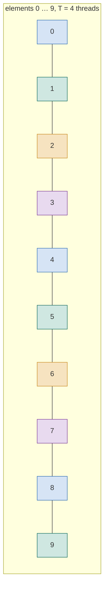

# 1. Basics

Series lessons 0–6 · full program: [01_basics.cpp](https://github.com/Prakash-sa/GPU-ultimatum/blob/main/docs/cpp/src/01_basics.cpp)

## main and printing

Execution starts in `main`, and returning 0 means success. Print with `std::cout`
(type-safe) or `printf`, which is also available inside CUDA kernels.

```cpp
int main() {
    std::cout << "Hello from the host\n";
    std::printf("%d threads, %.2f ms\n", 256, 1.25);
}
```

## Variables: pick the type for the hardware

| Type | Size | GPU note |
|---|---|---|
| `int` | 4 B | indices up to ~2.1 billion; past that, `int64_t` |
| `float` | 4 B | the GPU's native type. Write `0.1f`: plain `0.1` is a double |
| `double` | 8 B | 1/2 to 1/64 of FP32 speed, depending on the GPU |
| `unsigned` | 4 B | bit patterns: warp masks such as `0xffffffffu` |
| `auto` | — | the compiler deduces the type from the initializer |

```cpp
std::int64_t bytes = 4LL * n;      // byte counts overflow int quickly
const int threads = 256;           // const: fixed after initialization
```

## Conditionals

`if` / `else if` / `else`, the ternary `cond ? a : b`, and `switch`. C++17 lets
`if` and `switch` declare a variable that lives only inside them.

```cpp
int round_up(int n, int m) { return n % m == 0 ? n : (n / m + 1) * m; }
switch (int cc = 90; cc / 10) { case 8: /* Ampere */ break; case 9: /* Hopper */ break; }
```

## std::array: a fixed-size array that behaves like a value

The size is part of the type, the storage is inline (on the stack), and the overhead
is zero. It copies and compares like an `int`. A 2-D `std::array` is row-major, like a
shared-memory tile.

```cpp
std::array<float, 4> v{1, 2, 3, 4};
auto w = v;                         // a real copy
std::array<std::array<float, 3>, 2> tile{};   // 2 rows of 3, contiguous
```

## Loops

The index loop is the shape of every kernel body. The **grid-stride loop** is the same
loop split across T threads: thread t takes elements t, t+T, t+2T, …



```cpp
for (int i = 0; i < n; ++i) c[i] = a[i] + b[i];          // serial
for (int i = t; i < n; i += T) c[i] = a[i] + b[i];       // thread t of T (grid-stride)
for (float v : c) sum += v;                              // range-for: every element
for (auto& v : c) v = 0.0f;                              // & to modify in place
```

`while` tests before each pass; `do … while` runs the body at least once.
`while (offset > 0) offset /= 2;` takes 5 steps from 16: the 5 steps of a warp
reduction.
