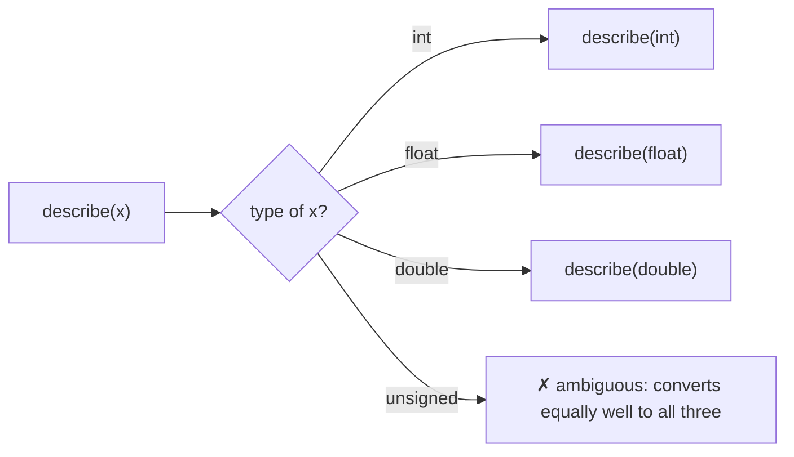
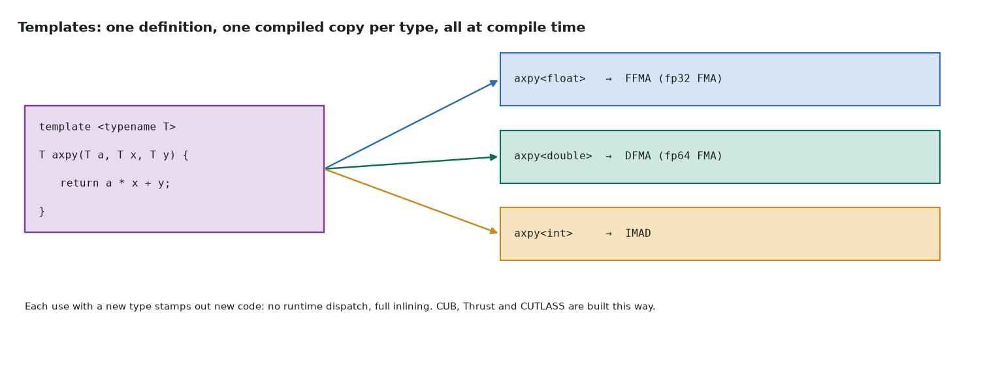

# 2. Functions and templates

Series lessons 7–10 · full program: [02_functions.cpp](https://github.com/Prakash-sa/GPU-ultimatum/blob/main/docs/cpp/src/02_functions.cpp)

## Functions

A declaration gives the signature; a definition gives the body. Default arguments fill
in from the right. To return several values, return a struct and unpack it with
structured bindings.

```cpp
int ceil_div(int a, int b) { return (a + b - 1) / b; }
int blocks_for(int n, int threads = 256) { return ceil_div(n, threads); }

struct Launch { int blocks, threads; };
auto [blocks, threads] = Launch{blocks_for(1'000'000), 256};
```

## Overloading: same name, chosen by argument types



CUDA uses this everywhere: `sqrtf` and `sqrt`, and `atomicAdd(int*, int)` vs
`atomicAdd(float*, float)`. Watch the literals: `1.0` is a `double` and `1.0f` is a
`float`. Picking the double overload by accident runs at FP64 speed.

## Templates: one definition, a compiled copy per type



```cpp
template <typename T>
T axpy(T a, T x, T y) { return a * x + y; }

template <typename T, int N>                 // N is a compile-time value: loops unroll
T sum_fixed(const T (&v)[N]) { T s{}; for (int i = 0; i < N; ++i) s += v[i]; return s; }
```

`axpy(2.0f, 3.0f, 4.0f)` deduces `T = float`. The cost is all at compile time, with
none at run time. Tile sizes in GPU kernels are template parameters for exactly this
reason.

## Specialization: a different answer for one type

```cpp
template <typename T> struct Accumulator { using type = T; };      // general case
template <> struct Accumulator<half_t> { using type = float; };     // FP16 sums in FP32
template <> struct Accumulator<float>  { using type = double; };    // reference sums
```

Inside one template, `if constexpr` picks a code path per type and discards the others
at compile time:

```cpp
if constexpr (std::is_same_v<T, float>) return 0x1p-23;   // FP32 epsilon
else                                     return 0x1p-52;   // FP64 epsilon
```
