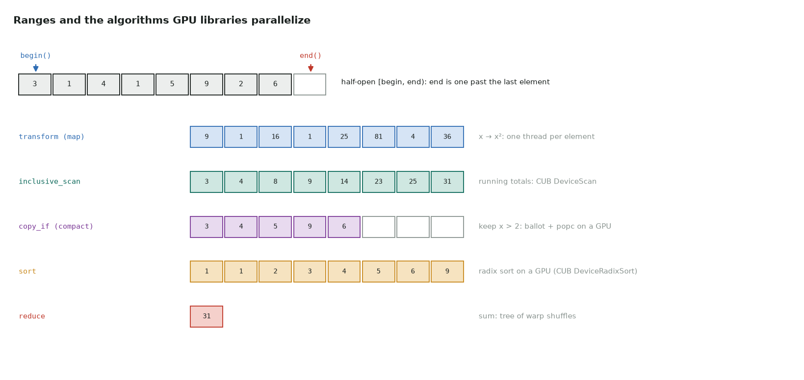

# 3. Iterators and algorithms

Series lessons 11–12 · full program: [03_iterators.cpp](https://github.com/Prakash-sa/GPU-ultimatum/blob/main/docs/cpp/src/03_iterators.cpp)



## Iterators

An iterator is a generalized pointer: `*it` reads, `++it` advances, and a range is
**half-open**, `[begin, end)`. A function written for iterators works on any container,
and on raw pointers too.

```cpp
template <typename It>
int count_negative(It first, It last) {
    int n = 0;
    for (It it = first; it != last; ++it) if (*it < 0) ++n;
    return n;
}
count_negative(v.begin(), v.end());   // vector
count_negative(raw, raw + 3);         // a pointer is an iterator
```

## std::sort and the algorithms GPU libraries copy

Each standard algorithm has a parallel GPU counterpart. Learn the serial one first; the
GPU version keeps its name and contract:

| `<algorithm>` / `<numeric>` | What it does | GPU version |
|---|---|---|
| `std::transform` | map: out[i] = f(in[i]) | one thread per element; `thrust::transform` |
| `std::accumulate` / `std::reduce` | sum (or any associative op) | tree of warp shuffles; `cub::DeviceReduce` |
| `std::inclusive_scan` | running totals | `cub::DeviceScan`; see [warp scans](../notes/13-warp-primitives.md#prefix-sum-__shfl_up_sync) |
| `std::copy_if` | keep matching elements, packed | ballot + popc compaction |
| `std::sort`, `std::stable_sort` | order by a key | radix sort: `cub::DeviceRadixSort` |
| `std::lower_bound` / `upper_bound` | binary search in sorted data | find a CSR row from an element index |

```cpp
std::stable_sort(p.begin(), p.end(),
                 [](const Particle& a, const Particle& b) { return a.cell < b.cell; });
```

Sorting particles by grid cell is how GPU codes make neighbour searches and
scatter-adds coalesced. "Stable" keeps equal keys in their original order.
