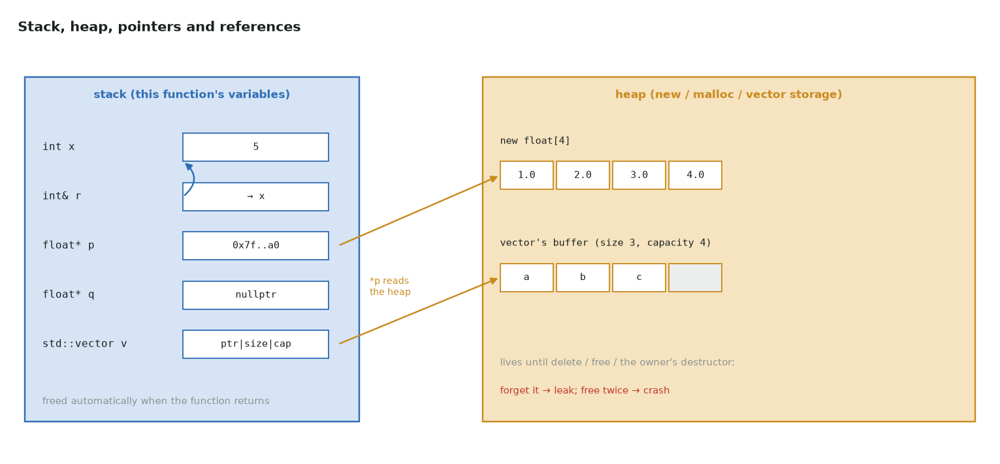
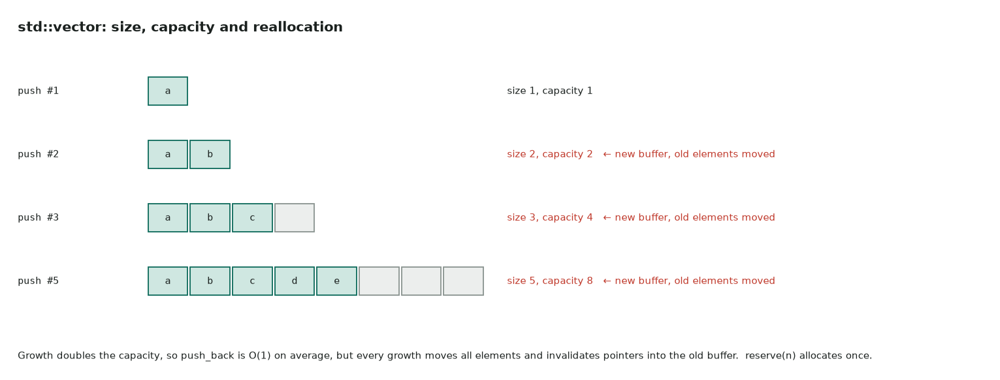
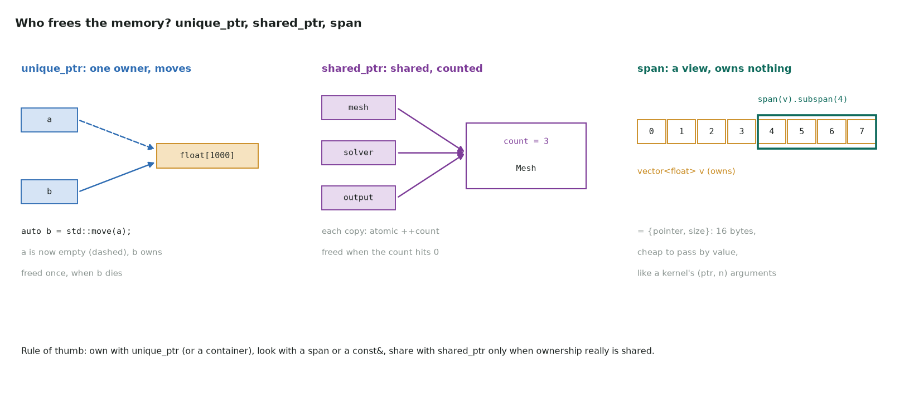

# 4. Memory

Series lessons 13–20 · full program: [04_memory.cpp](https://github.com/Prakash-sa/GPU-ultimatum/blob/main/docs/cpp/src/04_memory.cpp)



## std::vector

A growable array. Its storage is **contiguous** on the heap, so `.data()` is the
pointer you pass to `cudaMemcpy`.



```cpp
std::vector<float> v;
v.reserve(1 << 20);                  // one allocation up front: no reallocation, no moves
std::vector<float> m(rows * cols);   // 2-D data: one flat vector, m[r * cols + c]
```

Prefer one flat vector over `vector<vector<float>>`: the latter scatters its rows across
the heap, and you can't copy it to the GPU in one call.

## References and pass by reference

A reference is another name for an existing object: it can't be null and doesn't copy.

| Parameter | Copies? | Can modify? | Use for |
|---|---|---|---|
| `T v` | yes | its own copy | small things: `int`, `float`, small structs |
| `const T& v` | no | no | anything larger: vectors, strings |
| `T& v` | no | yes | outputs and in/out parameters |

CUDA kernels take every argument **by value**. Passing a `std::vector` to a kernel would
copy the vector object (a host pointer and sizes), never its data. Pass a device
pointer and a size instead.

## Pointers

```cpp
float a[4] = {1, 2, 3, 4};
float* p = a;          // points at a[0]; p[2] == *(p + 2) == 3
++p;                   // moves 4 bytes (sizeof(float))
float* q = nullptr;    // points nowhere: check before use
float** out = &p;      // pointer to pointer: how cudaMalloc returns an address
```

`const float* x` means "can't write through x": the right type for kernel inputs.

## Dynamic allocation, and why not to do it by hand

`new[]` must pair with `delete[]`, and `malloc` with `free`, on **every** path out of
the function. An early `return` or an exception between the two leaks the memory.
`cudaMalloc` / `cudaFree` have exactly the same problem. The fix is to let an object
own the memory:



## unique_ptr: one owner

```cpp
auto a = std::make_unique<float[]>(1000);   // freed when its owner goes out of scope
auto b = std::move(a);                      // ownership moves; a is now empty
struct FreeDeleter { void operator()(void* p) const { std::free(p); } };
std::unique_ptr<float[], FreeDeleter> buf(static_cast<float*>(std::malloc(n * 4)));
```

With a custom deleter it can own anything with a "free" function, including `cudaFree`
([part 9](09-cpp-in-cuda.md)).

## shared_ptr: shared ownership with a count

Each copy increments an atomic reference count, and the object is freed when the count
reaches 0. A `weak_ptr` observes without owning. It costs more than `unique_ptr`, so
use it only when ownership really is shared.

## span: a view that owns nothing

`std::span<const float>` is `{pointer, size}`. One function can then accept a vector,
an array or a raw buffer, and the size travels with the pointer. A device-array view
has the same shape.

```cpp
float dot(std::span<const float> a, std::span<const float> b);
auto tail = std::span(v).subspan(4);         // elements 4.., no copy
```
