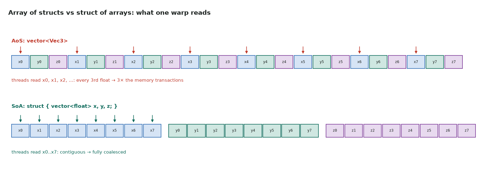
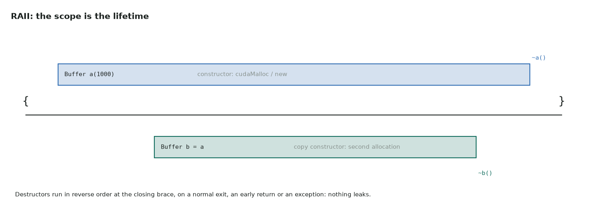
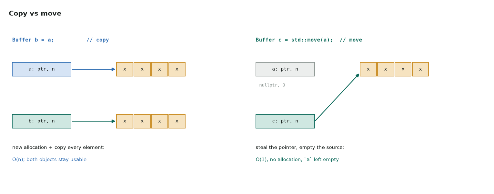

# 5. Objects

Series lessons 21–29 · full program: [05_objects.cpp](https://github.com/Prakash-sa/GPU-ultimatum/blob/main/docs/cpp/src/05_objects.cpp)

## Structs, and the layout question

A struct groups data; CUDA's `float2`, `float3` and `float4` are structs. With
millions of them, the layout decides how fast a GPU can read them:



```cpp
struct Vec3 { float x = 0, y = 0, z = 0; };       // default member initializers
Vec3 b{.x = 1.0f, .z = 3.0f};                     // designated initializers (C++20)
struct ParticlesSoA { std::vector<float> x, y, z; };   // what kernels want
```

## Classes: data plus the rules that keep it valid

Members are private by default, so the only way to change the object is through its
public functions. Those functions can then keep its **invariant** true (here, that the
mean matches the count). `const` member functions promise not to modify the object.

```cpp
class RunningMean {
public:
    void add(double v) { ++n_; mean_ += (v - mean_) / n_; }   // Welford update
    double mean() const { return mean_; }
private:
    long n_ = 0;
    double mean_ = 0.0;
};
```

## Constructors and destructors: RAII

The constructor acquires the resource, and the destructor releases it, always, in
reverse order of construction, even when an exception is thrown. This is how to wrap
`cudaMalloc`, streams, events and library handles.



```cpp
class Buffer {
public:
    explicit Buffer(std::size_t n) : n_(n), data_(new float[n]()) {}
    ~Buffer() { delete[] data_; }
    // ... copy and move, below
};
```

## Copy and move



- **Copy constructor** `Buffer(const Buffer&)`: a deep copy, with a new allocation.
- **Move constructor** `Buffer(Buffer&&) noexcept`: steals the pointer and leaves the
  source empty, in O(1).
- `std::move(x)` moves nothing by itself. It only marks `x` as "you may steal from
  this".

```cpp
Buffer(Buffer&& o) noexcept
    : n_(std::exchange(o.n_, 0)), data_(std::exchange(o.data_, nullptr)) {}
```

Mark moves `noexcept`. Otherwise `std::vector` copies elements instead of moving them
when it grows.

## Operator overloading

Operators give user types natural syntax. The CUDA samples ship `+`, `*` and `dot` for
`float2`/`float4` in `helper_math.h`. `operator()` makes an object callable: a
**functor**, as in part 6.

```cpp
Complex operator*(Complex a, Complex b) { return {a.re*b.re - a.im*b.im, a.re*b.im + a.im*b.re}; }
```

## push_back vs emplace_back

`push_back(Kernel("saxpy", 4096, 256))` builds a temporary and moves it in.
`emplace_back("saxpy", 4096, 256)` builds the element in place from the arguments.
For types that move cheaply the difference is small, and `reserve` matters more.
