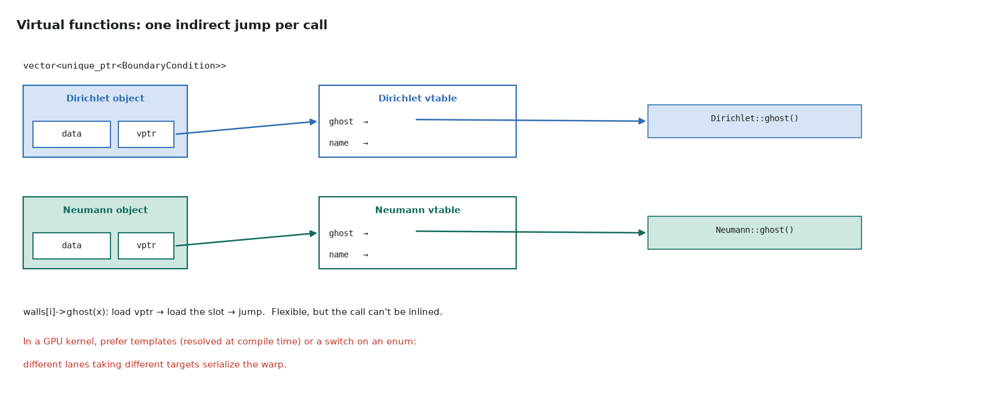
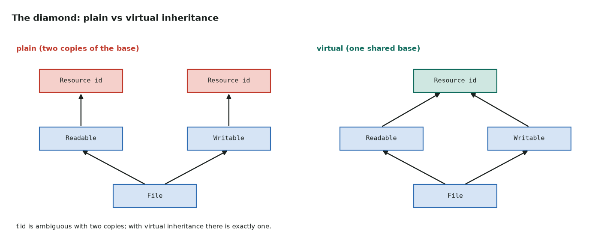
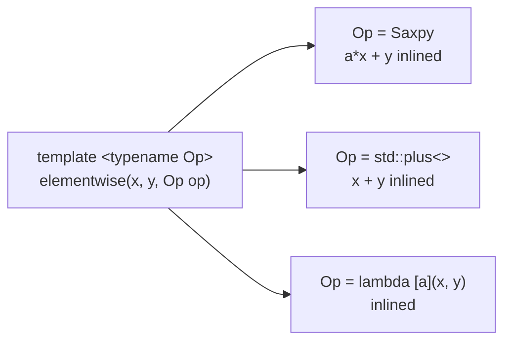

# 6. Polymorphism and generic code

Series lessons 30–38 · full program: [06_polymorphism.cpp](https://github.com/Prakash-sa/GPU-ultimatum/blob/main/docs/cpp/src/06_polymorphism.cpp)

## Inheritance

`struct Gpu : Device` means a Gpu **is a** Device: it has every member of `Device`
plus its own, and it binds to a `Device&`.

## Virtual functions and abstract classes



```cpp
class BoundaryCondition {
public:
    virtual ~BoundaryCondition() = default;
    virtual float ghost(float inner) const = 0;     // pure virtual: the class is abstract
};
class Neumann : public BoundaryCondition {
    float ghost(float inner) const override { return inner; }
};
```

The call is chosen at **run time** through the object's vtable. That is flexible on the
CPU. In a kernel, prefer the compile-time choice below: virtual calls can't be inlined,
work only for objects created on the device, and serialize a warp whose lanes call
different targets.

## Virtual inheritance: the diamond



## Class templates

```cpp
template <typename T, int N>
class SmallVec {                      // N known at compile time: loops unroll,
    std::array<T, N> v_{};            // the data can live in registers
public:
    T dot(const SmallVec& o) const { T s{}; for (int i = 0; i < N; ++i) s += v_[i] * o.v_[i]; return s; }
};
static_assert(sizeof(SmallVec<float, 4>) == 16);   // no overhead
```

## Default comparisons (C++20)

One line gives a struct all six comparisons, member by member:

```cpp
struct Version {
    int major, minor;
    auto operator<=>(const Version&) const = default;
    bool operator==(const Version&) const = default;
};   // Version{11, 8} < Version{12, 0}
```

## Function objects and lambdas: compile-time polymorphism

A functor or lambda passed to a template is inlined: no vtable, no indirect jump. This
is how CUB, Thrust and kernel templates take "the operation to perform".



```cpp
struct Saxpy { float a; float operator()(float x, float y) const { return a * x + y; } };
elementwise(x, y, Saxpy{3.0f});
elementwise(x, y, [a](float xi, float yi) { return a * xi + yi; });   // the same, as a lambda
```

| Capture | Meaning |
|---|---|
| `[a]` / `[=]` | copy `a` / everything used, when the lambda is created |
| `[&calls]` / `[&]` | refer to the outer variable: it must outlive the lambda |
| `[](auto u, auto v)` | a generic lambda: a template in disguise |

In CUDA, `[a] __device__ (float x, float y) { … }` makes the lambda callable on the
GPU (compile with `nvcc --extended-lambda`). Capture by value: a reference to a host
variable is meaningless on the device.
