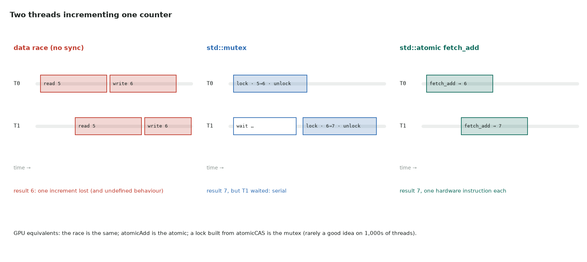

# 7. Parallel C++ on the CPU

Series lessons 39–42 · full program: [07_parallel.cpp](https://github.com/Prakash-sa/GPU-ultimatum/blob/main/docs/cpp/src/07_parallel.cpp)

The CPU versions of the ideas every GPU programmer meets: races, locks and atomics.



## Parallel STL algorithms

An execution policy asks the library to parallelize:

```cpp
double s = std::reduce(std::execution::par, v.begin(), v.end(), 0.0);
std::transform(std::execution::par_unseq, v.begin(), v.end(), v.begin(), [](double x) { return 2 * x; });
```

- With GCC the parallel backend is Intel TBB (`-ltbb`); without it the call runs
  serially.
- `nvc++ -stdpar` runs the **same code on an NVIDIA GPU**.
- `std::reduce` may add in any order, so float results can differ from
  `std::accumulate`. This is the same trade-off as GPU atomics.

## Threads

```cpp
std::vector<std::jthread> pool;                     // jthread joins in its destructor
for (int t = 0; t < T; ++t)
    pool.emplace_back([t, &partial] { for (int i = t; i < n; i += T) partial[t] += i; });
```

Each thread writes its own slot, so there is no race. Slots on the same 64-byte cache
line still slow each other down ("false sharing"). One host thread per GPU is a common
way to drive several GPUs.

## std::mutex

`std::lock_guard<std::mutex> lock(m);` holds the lock until the end of the scope (RAII
again). Everything inside runs one thread at a time, so keep it short.

## std::atomic

```cpp
std::atomic<long> counter{0};
counter.fetch_add(1, std::memory_order_relaxed);                  // = atomicAdd
while (v > cur && !max_seen.compare_exchange_weak(cur, v)) {}     // CAS loop = atomicMax for floats
```

| CPU | GPU |
|---|---|
| `std::atomic<T>::fetch_add` | `atomicAdd` |
| `compare_exchange_weak` | `atomicCAS` (in a loop) |
| `std::mutex` | a lock built from `atomicCAS`: usually a bad idea with thousands of threads |
| per-thread partials, then combine | per-block partials, then a second pass |

The GPU version of this lesson is [warp primitives](../notes/13-warp-primitives.md):
one atomic per warp instead of one per thread.
