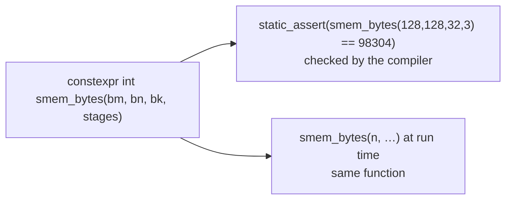

# 8. Special topics

Series lessons 43–47 · full program: [08_special.cpp](https://github.com/Prakash-sa/GPU-ultimatum/blob/main/docs/cpp/src/08_special.cpp)

## Namespaces

```cpp
namespace solver { int padded(int n, int order); }
namespace sv = solver;                  // alias
using solver::padded;                   // one name; never `using namespace` in a header
```

CUDA's libraries are organized the same way: `cub::`, `thrust::`, `cuda::std::`,
`nvcuda::wmma::`.

## Pseudo-random numbers

`<random>` separates the **engine** (the bit stream) from the **distribution** (the
shape of the numbers).

```cpp
std::mt19937 gen(42);                                   // fixed seed → same numbers every run
std::uniform_real_distribution<float> uni(-1.0f, 1.0f);
float x = uni(gen);
```

On a GPU every thread needs its own independent stream. cuRAND's Philox generator takes
`(seed, subsequence = thread id, offset)` for that reason. One shared engine can't serve
thousands of threads.

## File I/O

Write data as binary and logs as text:

```cpp
std::ofstream out("field.bin", std::ios::binary);
out.write(reinterpret_cast<const char*>(v.data()), v.size() * sizeof(float));   // exact
std::ofstream csv("timings.csv");  csv << "kernel,us\nsaxpy,12.5\n";            // readable
```

Text loses float precision unless you print 9 significant digits. Binary round-trips
bit for bit.

## constexpr: compute it at compile time



```cpp
constexpr int next_pow2(int n) { int p = 1; while (p < n) p <<= 1; return p; }
static_assert(next_pow2(1000) == 1024);
static_assert(smem_bytes(128, 128, 32, 3) <= 227 * 1024);   // fits an H100's shared memory
```

Tile sizes, shared-memory budgets and lookup tables computed this way cost nothing at
run time, and the compiler checks them.

## Concepts (C++20): say what a template needs

```cpp
template <typename T>
concept Scalar = std::floating_point<T> || std::integral<T>;

template <Scalar T> T fma_like(T a, T b, T c) { return a * b + c; }
// fma_like(std::string{}, …) → one line: "constraints not satisfied: Scalar"
```

Without a concept, a wrong type produces pages of errors from inside the template. With
one, the error is a single line at the call.
