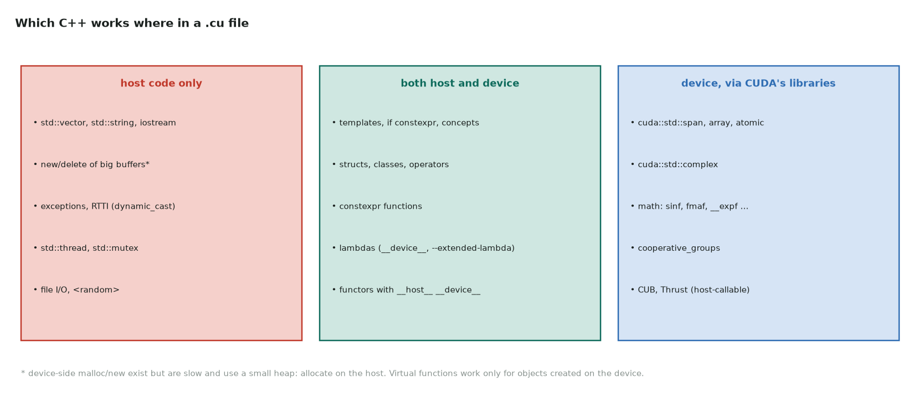

# 9. The same C++ inside CUDA

Full program: [09_cpp_in_cuda.cu](https://github.com/Prakash-sa/GPU-ultimatum/blob/main/docs/cpp/src/09_cpp_in_cuda.cu)

A `.cu` file mixes host code (normal C++) and device code (a subset). Most of parts 1–8
carries over:



## Five patterns that carry over

**1. RAII for device memory** ([part 4](04-memory.md), [part 5](05-objects.md)). A
`unique_ptr` with a `cudaFree` deleter frees the memory on every path:

```cpp
struct CudaFree { void operator()(void* p) const { cudaFree(p); } };
template <typename T> using device_ptr = std::unique_ptr<T[], CudaFree>;
auto d_x = device_alloc<float>(n);        // freed at the closing brace, even after a throw
```

**2. A view type as a kernel argument** ([part 4](04-memory.md)). Kernels take
arguments by value, so pass `{pointer, size}`. It must be trivially copyable:

```cpp
template <typename T> struct View {
    T* data; int size;
    __host__ __device__ T& operator[](int i) const { return data[i]; }
};
```

**3. A kernel template that takes the operation** ([part 6](06-polymorphism.md)). This
is the design of Thrust and CUB:

```cpp
template <typename Op>
__global__ void transform_kernel(View<const float> x, View<float> y, Op op) {
    for (int i = blockIdx.x * blockDim.x + threadIdx.x; i < x.size; i += gridDim.x * blockDim.x)
        y[i] = op(x[i], y[i]);                         // inlined: no function-call cost
}
transform(x, y, Saxpy{2.5f});                                          // a functor
transform(x, y, [a] __device__(float xi, float yi) { return a * xi + yi; });   // a lambda
```

**4. constexpr and static_assert for launch parameters** ([part 8](08-special.md)):

```cpp
constexpr int kThreads = 256;
static_assert(kThreads % 32 == 0, "block size must be a whole number of warps");
```

**5. if constexpr in device code** ([part 2](02-functions.md)), here widening the
accumulator per type:

```cpp
template <typename T> __device__ auto widen(T v) {
    if constexpr (std::is_same_v<T, float>) return double(v); else return v;
}
```

## The rules at the boundary

| Rule | Why |
|---|---|
| Kernel arguments are copied by value | pass pointers and sizes, never `std::vector` |
| Host code may throw; device code can't | check `cudaError_t` on the host and turn it into an exception there |
| `__device__` lambdas need `--extended-lambda` and should capture by value | a captured host reference means nothing on the GPU |
| Kernel templates need their arguments at the launch | `transform_kernel<Op><<<…>>>` is explicit and always works |
| `std::` containers stay on the host | on the device, use `cuda::std::` (libcu++) types or plain arrays |

## How it was checked

The file runs in the repo's CPU emulator: a functor and a lambda SAXPY, and an RAII
round trip, at sizes from 1 to 300,001. All 12 checks pass. It also builds with nvcc
12.6 for sm_75 and sm_90 with `-std=c++20 --extended-lambda`, with warnings treated as
errors. It has not been run on a GPU.
