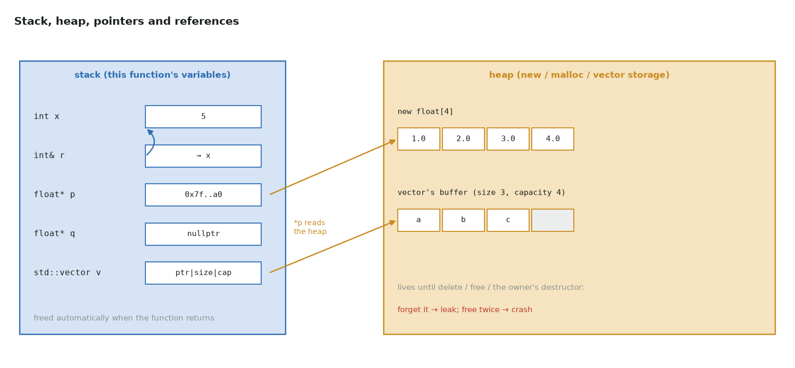

# C++ for GPU programmers

CUDA kernels are written in C++, and so are the libraries that run them (CUB, Thrust,
CUTLASS, PyTorch's ATen). This short course covers the C++ you need, one picture and a
few lines of code at a time. Each topic says how it shows up in GPU code.

It follows the outline of **[C++ From Scratch](https://github.com/CoffeeBeforeArch/cpp_from_scratch)**
by CoffeeBeforeArch (a YouTube series; its code is GPL-3.0). The explanations, figures
and examples here are original. Watch the series for the narrated version of each
lesson.



## The course

| Part | Lessons (series numbering) | The picture to remember |
|---|---|---|
| [1. Basics](01-basics.md) | 0–6: main, printing, variables, conditionals, `std::array`, loops | a loop over `i` is a kernel body |
| [2. Functions and templates](02-functions.md) | 7–10: functions, overloading, templates, specialization | one template, one compiled copy per type |
| [3. Iterators and algorithms](03-iterators.md) | 11–12: iterators, `std::sort`, and friends | `[begin, end)`; map, scan, compact, sort, reduce |
| [4. Memory](04-memory.md) | 13–20: `vector`, references, pointers, `new`, `unique_ptr`, `shared_ptr`, `span` | stack vs heap, and who frees what |
| [5. Objects](05-objects.md) | 21–29: structs, classes, constructors, destructors, copy, operators, move, `emplace_back` | RAII: the scope is the lifetime |
| [6. Polymorphism and generic code](06-polymorphism.md) | 30–38: inheritance, virtual functions, class templates, `<=>`, functors, lambdas | vtable jump vs inlined template |
| [7. Parallel C++ on the CPU](07-parallel.md) | 39–42: parallel algorithms, threads, mutex, atomic | race vs lock vs atomic |
| [8. Special topics](08-special.md) | 43–47: namespaces, random numbers, file I/O, `constexpr`, concepts | compute it at compile time |
| [9. The same C++ inside CUDA](09-cpp-in-cuda.md) | — | what works on host, device, or both |

## Run the code

Every snippet comes from a complete program in [`docs/cpp/src/`](https://github.com/Prakash-sa/GPU-ultimatum/tree/main/docs/cpp/src).
Each program checks its own results with `assert`:

```bash
g++ -std=c++20 -Wall -Wextra -Werror -fsanitize=address,undefined docs/cpp/src/04_memory.cpp && ./a.out
bash tests/cpp/run.sh                     # all eight, with AddressSanitizer / ThreadSanitizer
```

Parts 1–8 build cleanly with GCC 14, warnings treated as errors, and pass under
AddressSanitizer and UndefinedBehaviorSanitizer (ThreadSanitizer for part 7). Part 9 is a
`.cu` file. It is tested in the repo's CPU emulator and compiled with nvcc 12.6 for
sm_75 and sm_90.
