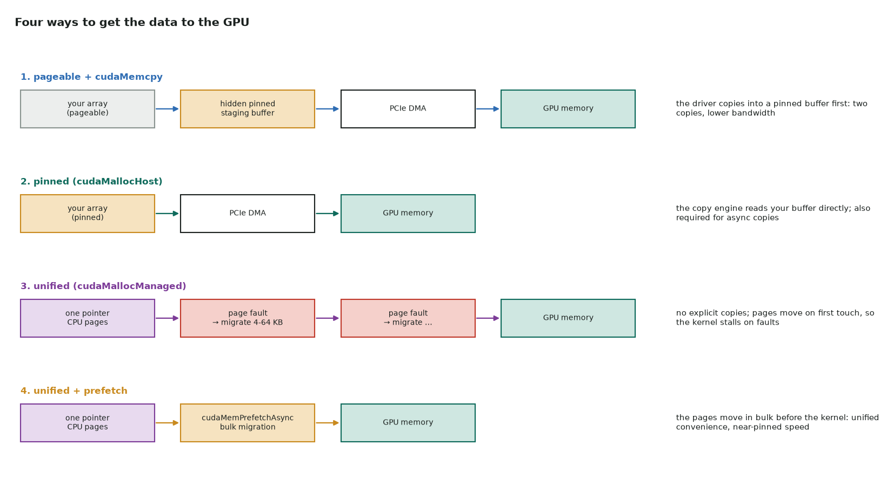

# 1. Vector addition: moving the data

Full program: [01_vector_add.cu](https://github.com/Prakash-sa/GPU-ultimatum/blob/main/docs/cuda-course/src/01_vector_add.cu)

The kernel is two lines. It runs the same in all four steps:

```cuda
int i = blockIdx.x * blockDim.x + threadIdx.x;   // one thread per element
if (i < n) c[i] = a[i] + b[i];                    // the last block overhangs n
```

What changes is how `a`, `b` and `c` get between the CPU and the GPU. That costs far more
than the addition: PCIe moves roughly 12–55 GB/s (Gen3 to Gen5), while the GPU's own
memory moves 0.3–3+ TB/s.



## The four steps

| Step | Allocation | What changes |
|---|---|---|
| 1. baseline | `new`/`malloc` + `cudaMalloc` | `cudaMemcpy` from pageable memory: the driver stages it through a hidden pinned buffer |
| 2. pinned | `cudaMallocHost` | the copy engine DMAs straight from your buffer: faster copies, and the only way to make `cudaMemcpyAsync` truly asynchronous |
| 3. unified | `cudaMallocManaged` | one pointer for CPU and GPU, no copies in your code; pages migrate when the GPU first touches them (page faults inside the kernel) |
| 4. unified + prefetch | `cudaMallocManaged` + `cudaMemPrefetchAsync` | pages move in bulk before the kernel, and back after it |

```cuda
// 2. pinned: allocate host memory the GPU can DMA from
cudaMallocHost(&p_a, bytes);
cudaMemcpy(d_a, p_a, bytes, cudaMemcpyHostToDevice);

// 3. unified: no cudaMemcpy at all; sync before the CPU reads the result
cudaMallocManaged(&a, bytes);
vector_add<<<blocks, 256>>>(a, b, c, n);
cudaDeviceSynchronize();

// 4. prefetch: move the pages before the kernel needs them
cudaMemPrefetchAsync(a, bytes, device);
cudaMemPrefetchAsync(c, bytes, cudaCpuDeviceId);   // result back to the CPU
```

## What to measure

- `nsys profile --stats=true` shows the time in **CUDA memcpy HtoD/DtoH** for steps 1–2.
  For steps 3–4 it shows **Unified Memory** page faults and migrations instead.
- Pinned memory isn't free: it can't be swapped out, so allocating gigabytes of it
  starves the OS. Allocate it once and reuse it.
- The real lesson: for one vector add, the PCIe transfer costs far more than the
  kernel. Keep data on the GPU across many kernels. See
  [streams](../notes/04-streams.md) for overlapping copies with compute.

!!! note "CUDA 13"
    In CUDA 13, `cudaMemPrefetchAsync` takes a `cudaMemLocation` instead of a device
    number. The code here uses the CUDA 12 form.
