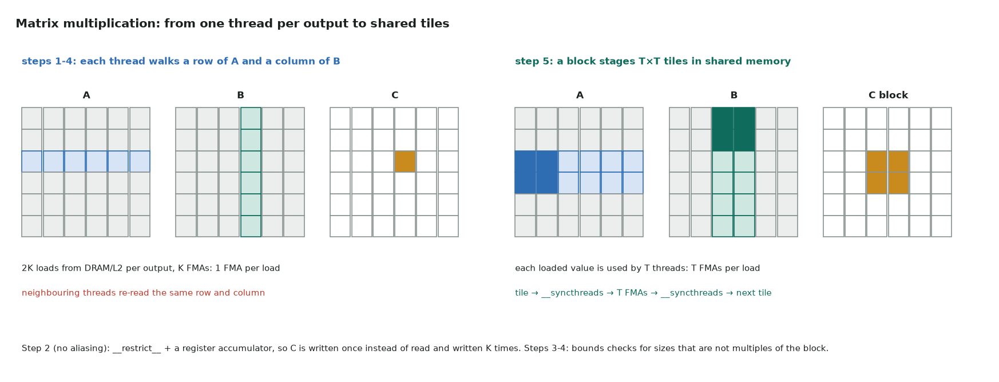
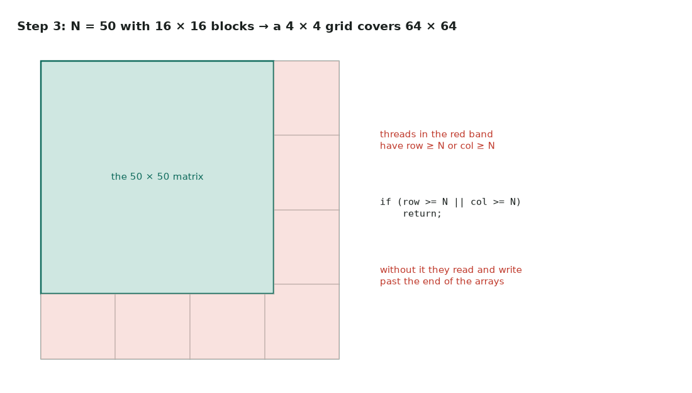

# 2. Matrix multiplication: reuse

Full program: [02_matmul.cu](https://github.com/Prakash-sa/GPU-ultimatum/blob/main/docs/cuda-course/src/02_matmul.cu)

Every step uses one thread per output element of C. The question is how many times each
value of A and B is fetched from memory.



## The five steps

| Step | What changes | Why it helps |
|---|---|---|
| 1. baseline | `c[row*N+col] += a[..] * b[..]` inside the loop | (starting point) C is read and written K times |
| 2. no aliasing | `__restrict__` and a register accumulator | the compiler may keep the sum in a register and load more freely: one store at the end |
| 3. non-multiple | `if (row >= N \|\| col >= N) return;` | correct for any N, not just multiples of 16 |
| 4. rectangular | A is M × K, B is K × N | real shapes; the indexing uses three sizes |
| 5. tiled | 16 × 16 tiles of A and B in `__shared__` memory | each loaded value feeds 16 FMAs instead of 1 |

```cuda
// 1 → 2: accumulate in a register, store once
float acc = 0.0f;
for (int k = 0; k < N; ++k) acc += a[row * N + k] * b[k * N + col];
c[row * N + col] = acc;
```



```cuda
// 5: load a tile, sync, use it 16 times, sync, next tile
As[ty][tx] = (row < M && k0 + tx < K) ? a[row * K + k0 + tx] : 0.0f;
Bs[ty][tx] = (k0 + ty < K && col < N) ? b[(k0 + ty) * N + col] : 0.0f;
__syncthreads();                                   // the tiles are complete
for (int k = 0; k < T; ++k) acc += As[ty][k] * Bs[k][tx];
__syncthreads();                                   // done before they are overwritten
```

In the tiled kernel, threads past the edge **don't return early**. They still load
(zeros) and still reach both `__syncthreads()`, because a barrier that some threads
skip is undefined behaviour. They only skip the final store.

## What to measure

- Effective GFLOP/s = $2MNK / t$. Steps 1–4 run at a small fraction of the GPU's peak;
  step 5 is several times faster.
- In Nsight Compute, compare **DRAM bytes** and **L1/shared throughput** for steps 4
  and 5: tiling cuts global memory traffic by about the tile width.
- Where to go next: register blocking (each thread computes 8 × 8 outputs), double
  buffering and tensor cores. This continues as the
  [SGEMM ladder](../leetgpu/21-matrix-multiplication.md#scaling-up-the-sgemm-ladder).
