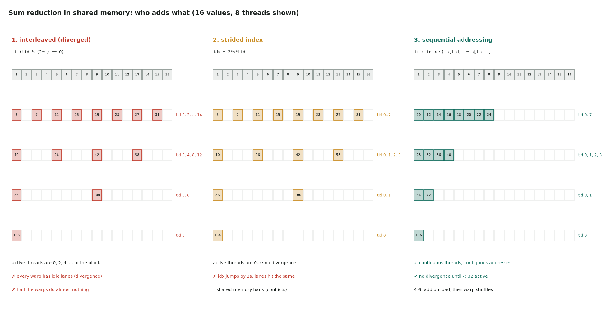

# 3. Sum reduction: six steps

Full program: [03_reduction.cu](https://github.com/Prakash-sa/GPU-ultimatum/blob/main/docs/cuda-course/src/03_reduction.cu)

Each block sums 256 (or 512) values into one, and the host relaunches the kernel on the
partial sums until one value is left. Each step changes **who adds which pair**:



## The six steps

| Step | The loop body | What it fixes |
|---|---|---|
| 1. diverged | `if (tid % (2*s) == 0) s[tid] += s[tid+s];` | (starting point) active threads 0, 2, 4, …: every warp diverges |
| 2. bank conflicts | `idx = 2*s*tid; if (idx < B) s[idx] += s[idx+s];` | active threads are now contiguous, but lanes collide on shared-memory banks |
| 3. no conflicts | `if (tid < s) s[tid] += s[tid+s];` with `s` halving from B/2 | contiguous threads read contiguous addresses: no divergence, no conflicts |
| 4. reduce idle | load `in[i] + in[i+B]` | half the threads sat idle after the first step; now each adds two values while loading, and half the blocks are needed |
| 5. warp shuffles | the last 32 values with `__shfl_down_sync` | the final 5 steps need no shared memory and no `__syncthreads` |
| 6. cooperative groups | `cg::reduce(tile, v, cg::plus<int>())` | the same as 5, written with group objects |

```cuda
// 3: sequential addressing
for (int stride = B / 2; stride > 0; stride >>= 1) {
    if (tid < stride) s[tid] += s[tid + stride];
    __syncthreads();
}

// 4: the first add happens during the load
s[tid] = (i < n ? in[i] : 0) + (i + B < n ? in[i + B] : 0);

// 5: the last warp finishes in registers
if (tid < 32) {
    int v = s[tid] + s[tid + 32];
    for (int o = 16; o > 0; o >>= 1) v += __shfl_down_sync(0xffffffffu, v, o);
}
```

!!! warning "Step 5 differs from older tutorials"
    Many older versions unroll the last warp with `volatile` shared memory and no
    synchronization ("warp-synchronous" code). Since Volta (2017), the lanes of a warp
    can drift apart, and that code is occasionally wrong. Use shuffles, as here, or put
    `__syncwarp()` between steps. See [warp primitives](../notes/13-warp-primitives.md#masks-and-convergence-what-goes-wrong).

## What to measure

- Effective bandwidth = bytes read / time. A good reduction reaches 80–90% of DRAM
  bandwidth, and steps 4–6 get close.
- Nsight Compute shows each fix directly:
  - **Branch efficiency** rises from step 1 to step 2.
  - **Shared-memory bank conflicts** drop to 0 at step 3.
  - **Number of blocks** halves at step 4.
- Integers make every step return the exact same answer. With floats, steps that add
  in a different order give slightly different bits.
