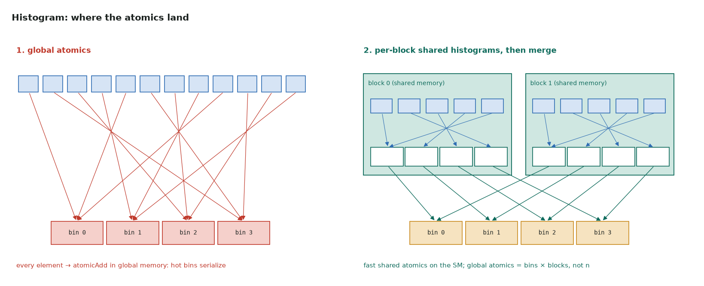

# 4. Histogram: contention

Full program: [04_histogram.cu](https://github.com/Prakash-sa/GPU-ultimatum/blob/main/docs/cuda-course/src/04_histogram.cu)

Thousands of threads all increment a handful of counters. Every increment must be an
atomic, and atomics on the same address take turns.



## The two steps

| Step | Where the atomics go | Global atomics |
|---|---|---|
| 1. global atomics | `atomicAdd(&hist[x[i]], 1)` for every element | n: hot bins serialize across the whole GPU |
| 2. shared atomics | each block counts into a private `__shared__` histogram, then adds it to the global one | bins × blocks |

```cuda
// 2: private histogram per block
__shared__ int local[256];
for (int b = threadIdx.x; b < nbins; b += blockDim.x) local[b] = 0;
__syncthreads();
for (int i = …; i < n; i += gridDim.x * blockDim.x) atomicAdd(&local[x[i]], 1);
__syncthreads();
for (int b = threadIdx.x; b < nbins; b += blockDim.x)
    if (local[b]) atomicAdd(&hist[b], local[b]);   // merge: one atomic per bin
```

Shared-memory atomics are executed on the SM, close to the threads. The global ones
travel to L2, so moving the contention into shared memory is what pays.

## What to measure

- Try skewed input, such as 90% of values in one bin. Step 1 slows sharply, while step 2
  barely changes.
- The grid is fixed at a few blocks per SM with a grid-stride loop. More blocks would
  mean more merge atomics for no gain.
- Going further: per-warp histograms, or `__match_any_sync` to aggregate equal keys
  within a warp before the atomic ([warp primitives](../notes/13-warp-primitives.md#match-and-warp-reduce)).
