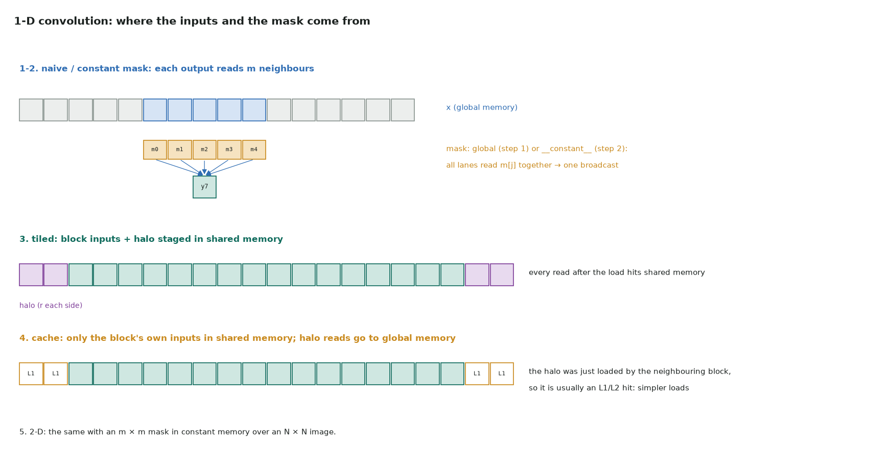

# 5. Convolution: where each input comes from

Full program: [05_convolution.cu](https://github.com/Prakash-sa/GPU-ultimatum/blob/main/docs/cuda-course/src/05_convolution.cu)

$y_i = \sum_{j=0}^{m-1} x_{i-r+j} \cdot \text{mask}_j$ with $r = m/2$ and zeros outside
the input. Each output reads *m* inputs, and neighbouring outputs share *m − 1* of them.
The steps differ in where those reads are served from.



## The five steps

| Step | Inputs from | Mask from | Why |
|---|---|---|---|
| 1. naive | global memory | global memory | (starting point) |
| 2. constant memory | global memory | `__constant__` | every lane reads the same `mask[j]` at the same time: the constant cache broadcasts it in one transaction |
| 3. tiled | shared memory (block + halo) | `__constant__` | the m-fold reuse of each input is served from shared memory |
| 4. cache | shared memory (block only); halo from global | `__constant__` | simpler loading; the halo was just read by the neighbouring block, so it's usually an L1/L2 hit |
| 5. 2-D | global memory | `__constant__` m × m | the same idea on an image |

```cuda
// 2: the mask in constant memory, filled from the host
__constant__ float c_mask[31 * 31];
cudaMemcpyToSymbol(c_mask, h_mask, m * sizeof(float));

// 3: stage the block's inputs plus a halo of r on each side
for (int t = threadIdx.x; t < blockDim.x + 2 * r; t += blockDim.x) {
    int k = base + t;
    tile[t] = (k >= 0 && k < n) ? x[k] : 0.0f;    // zero padding at the edges
}
__syncthreads();
for (int j = 0; j < m; ++j) acc += tile[threadIdx.x + j] * c_mask[j];
```

Constant memory is fast only when all lanes of a warp read the **same** address. If
lanes read different addresses, the reads serialize. That's why the mask goes there and
the inputs don't.

## What to measure

- Steps 1 → 2: fewer instructions and fewer load transactions per output.
- Steps 2 → 3 → 4: on modern GPUs, step 4 is often as fast as step 3, because L1 catches
  the halo. Measure it before writing the more complex kernel.
- The same reuse problem in 2-D and 3-D, at scale, is the
  [stencils note](../notes/12-stencils-and-discretization.md).
