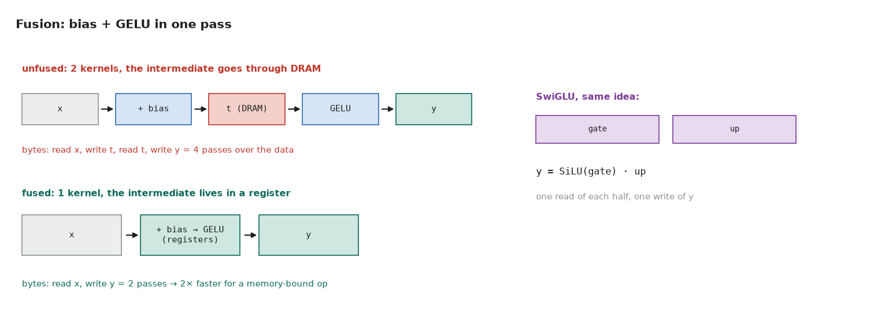

# 1. Fused bias + GELU and SwiGLU

Full code: [01_activations.cu](https://github.com/Prakash-sa/GPU-ultimatum/blob/main/docs/kernels/src/01_activations.cu) · used in every transformer MLP block



Elementwise operations do almost no arithmetic per byte, so their time is the time to
read and write memory. Run unfused, each step reads its whole input from DRAM and writes
its whole output back. Fused, the intermediate values only ever exist in registers.

```cuda
float4 v = x[i], b = bias[i % n4];                      // 16-byte loads
y[i] = make_float4(gelu(v.x + b.x), gelu(v.y + b.y),    // add + GELU in registers
                   gelu(v.z + b.z), gelu(v.w + b.w));

y[i] = silu(r[col]) * r[H + col];                       // SwiGLU: gate half × up half
```

| | |
|---|---|
| Bound by | memory bandwidth: 8 bytes per element (read + write) |
| Speed-up from fusing | about 2× for bias + GELU (4 passes → 2), more for longer chains |
| Watch out | exact GELU uses `erff`; the tanh approximation is a different function, so match the model you're serving |
| In practice | fused into the GEMM epilogue itself ([LeetGPU 17](../leetgpu/17-fused-layernorm-linear-gelu.md)) |

Tested against `F.gelu(x + b)` and `F.silu(gate) * up`, including row lengths that aren't a
multiple of 4, which take the scalar path.
