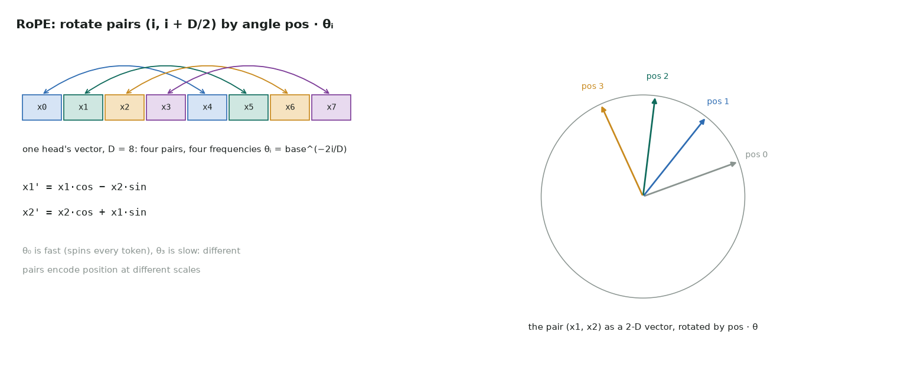

# 2. Rotary position embedding (RoPE)

Full code: [02_rope.cu](https://github.com/Prakash-sa/GPU-ultimatum/blob/main/docs/kernels/src/02_rope.cu) · applied to Q and K in LLaMA, GPT-NeoX and most current LLMs



Each pair of elements in a head's vector is treated as a 2-D vector and rotated by an
angle proportional to the token's position. Each pair turns at its own frequency.
Attention scores then depend only on the *relative* position of two tokens.

```cuda
int i = p % half;                                   // which frequency
float theta = expf(-log_base * (2.0f * i) / D);     // base^(-2i/D)
float ang = float(t + pos0) * theta, c = cosf(ang), s = sinf(ang);
float a = row[i], b = row[i + half];                // the pair (i, i + D/2)
row[i]        = a * c - b * s;
row[i + half] = b * c + a * s;
```

| | |
|---|---|
| Bound by | memory: one read and one write of Q/K. sin/cos computed on the fly avoid reading a table |
| Layouts | "rotate half" pairs (i, i + D/2), used by NeoX and LLaMA (as here); GPT-J pairs (2i, 2i + 1). Match the checkpoint |
| `pos0` | the position of the first token: non-zero when decoding with a KV cache |
| Watch out | `float(pos) * theta` loses precision at very long contexts; production kernels compute the angle in higher precision or use tables |

Tested against a float64 PyTorch reference, including `pos0 = 1000`.
