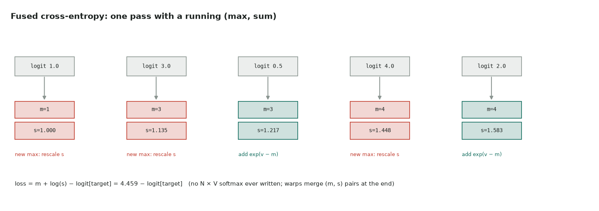

# 3. Fused cross-entropy

Full code: [03_cross_entropy.cu](https://github.com/Prakash-sa/GPU-ultimatum/blob/main/docs/kernels/src/03_cross_entropy.cu) · the loss of every language model

$\text{loss}_r = \log\sum_j e^{z_{rj}} - z_{r,\text{target}_r}$, with logits of shape N × V
(V ≈ 50,000–250,000).



The unfused version materializes softmax probabilities, an N × V array as large as the
logits, only to take one log of each row. The fused version reads each logit once and
keeps two numbers per thread. Those are the running max `m` and the sum `s` of
`exp(z - m)`, rescaled whenever the max grows. Warps then merge their `(m, s)` pairs
with shuffles.

```cuda
float v = row[j];
if (v > m) { s = s * expf(m - v) + 1.0f; m = v; }   // new max: rescale what we have
else         s += expf(v - m);
// … merge (m, s) across lanes and warps …
loss = M + logf(S) - row[target];
```

| | |
|---|---|
| Bound by | one read of the logits (N × V × 4 bytes) |
| Numerics | subtracting the max keeps `exp` from overflowing even at logit 1000 |
| The same trick | online softmax and FlashAttention ([LeetGPU 18](../leetgpu/18-softmax-attention.md)) |
| Further | the backward pass is `softmax − one_hot`. Fusing it with the loss into the LM-head GEMM avoids ever storing the logits, which saves gigabytes at V = 256k |

Tested against `F.cross_entropy(…, reduction="none")` in float64, up to V = 50,257.
