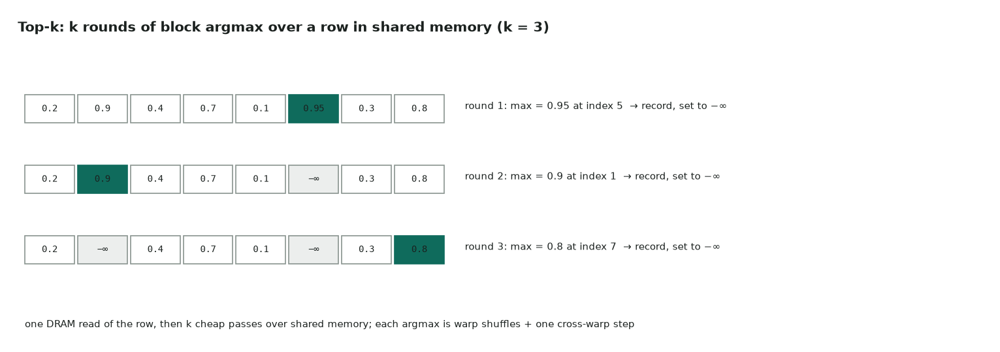

# 4. Top-k per row

Full code: [04_topk.cu](https://github.com/Prakash-sa/GPU-ultimatum/blob/main/docs/kernels/src/04_topk.cu) · token sampling, beam search, mixture-of-experts routing



When k is small (1–64) and a row fits in shared memory, the simplest fast method is:
read the row once, then repeat k times: find the block-wide maximum, record it, and
replace it with −∞.

```cuda
for (int j = threadIdx.x; j < V; j += blockDim.x) row[j] = src[j];   // one DRAM read
for (int r = 0; r < k; ++r) {
    VI best = {-INF, MAX_INT};
    for (int j = threadIdx.x; j < V; j += blockDim.x) best = better(best, {row[j], j});
    // warp shuffles → one value per warp → thread 0 picks the winner
    // thread 0: record it, row[winner] = -INF;  __syncthreads();
}
```

| | |
|---|---|
| Cost | one DRAM read of the row, plus k × V shared-memory reads |
| Ties | broken toward the lower index, so results are deterministic |
| Limits | V ≤ 8192 (32 KB of shared memory), k small |
| Larger k or V | radix select (find the k-th value by digits, then filter), or bitonic top-k |

Tested against `torch.topk` for both values and indices, up to V = 8192 and k = 64.
Removing the barrier between rounds makes the tests fail.
