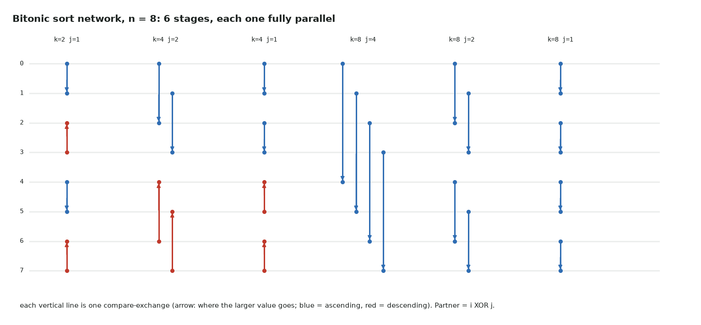

# 5. Bitonic sort

Full code: [05_bitonic_sort.cu](https://github.com/Prakash-sa/GPU-ultimatum/blob/main/docs/kernels/src/05_bitonic_sort.cu) · sorting inside a block, small sorts, top-k building block



A sorting network is a fixed sequence of compare-exchange stages that doesn't depend on
the data. Every stage compares n/2 independent pairs (partner = `i XOR j`), so it maps
perfectly onto threads, with no branching on data.

```cuda
int i = 2 * t - (t & (j - 1));          // the lower index of thread t's pair
bool asc = (i & k) == 0;                // direction alternates in blocks of k
if ((a[i] > a[i + j]) == asc) swap(a[i], a[i + j]);
```

| Stage distance j | Where it runs |
|---|---|
| j < 2 × 256 | inside one block, in shared memory: many stages per launch |
| j ≥ 512 | one global-memory kernel per stage |

| | |
|---|---|
| Work | O(n log² n): more than radix sort's O(n · passes) |
| Strength | simple, branch-free, data-independent, sorts in place |
| Any n | padded to a power of two with +∞ |

Tested against `torch.sort` from n = 1 to 70,001, with duplicate values.
