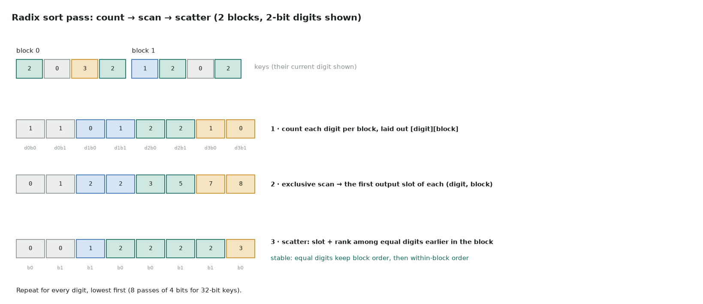

# 6. Radix sort

Full code: [06_radix_sort.cu](https://github.com/Prakash-sa/GPU-ultimatum/blob/main/docs/kernels/src/06_radix_sort.cu) · argsort, binning particles by cell, MoE token dispatch



Sort by 4 bits at a time, starting with the lowest digit. Each pass must be **stable**,
meaning equal digits keep their order, so the order from earlier digits survives. That
takes eight passes for 32-bit keys, and each pass is three kernels:

1. **count**: each block makes a 16-bin histogram of its digits;
2. **scan**: an exclusive scan over the counts, laid out `[digit][block]`, gives each
   (digit, block) its first output slot;
3. **scatter**: each element goes to its slot plus its rank among equal digits earlier in
   its block.

```cuda
unsigned peers = __match_any_sync(FULL, digit);              // lanes with my digit
unsigned rank  = __popc(peers & ((1u << lane) - 1));          // ... before me in the warp
// + counts of my digit in earlier warps (shared memory)
dst = offsets[digit * nblocks + blockIdx.x] + before + rank;
```

| | |
|---|---|
| Work | O(n × passes): 8 passes × (read + write keys and values) |
| Stability | in-warp rank from `__match_any_sync`, then earlier warps, then earlier blocks |
| Production | CUB `DeviceRadixSort` / `torch.sort` use the same structure, with 8-bit digits, onesweep and decoupled look-back |
| Floats | flip the bits first (negative: all bits; positive: the sign bit), so they sort as unsigned ints |

Tested against PyTorch's stable `argsort` for keys and values. A third of the keys are
duplicates, so stability is actually exercised. Removing a barrier in the scatter makes
the tests fail.
