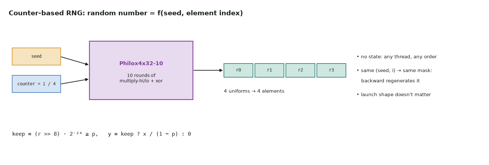

# 7. Dropout with a counter-based RNG

Full code: [07_dropout.cu](https://github.com/Prakash-sa/GPU-ultimatum/blob/main/docs/kernels/src/07_dropout.cu) · training-time regularization; the same RNG drives sampling and noise



A conventional generator carries state that each step updates, so it can't be shared
by thousands of threads. A **counter-based** generator has no state: the random number
for element i is a pure function of `(seed, i)`. Philox4x32-10, the generator in cuRAND
and PyTorch, does 10 rounds of multiply-high/low and XOR, and returns 4 numbers per
call.

```cuda
U4 r = philox4x32_10({g, g >> 32, 0, 0}, seed_lo, seed_hi);   // counter = group of 4
for (int q = 0; q < 4; ++q) {
    bool keep = (rs[q] >> 8) * 0x1p-24f >= p;
    y[4 * g + q] = keep ? x[4 * g + q] / (1 - p) : 0.0f;
}
```

| Property | Why it matters |
|---|---|
| No state | any thread, any launch shape, any order: same mask |
| Same `(seed, i)` → same bit | the backward pass regenerates the mask instead of storing it |
| `1 / (1 − p)` scaling | keeps each activation's expected value equal at train and test time |

**Testing:**

- **Correct generator:** it reproduces the Random123 known-answer vectors exactly.
- **Correct mask:** the GPU mask equals a pure-Python Philox bit for bit.
- **Statistics:** the keep fraction is 1 − p ± 0.01.
- **Determinism:** the same seed gives the same mask, and a new seed gives a different
  one.

The mapping from counters to elements differs from PyTorch's, so the masks match
PyTorch's statistics but not its exact bits.
