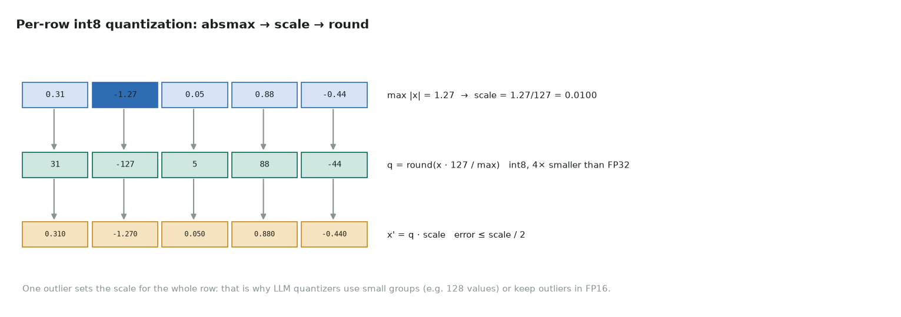

# 8. Int8 quantization

Full code: [08_int8_quant.cu](https://github.com/Prakash-sa/GPU-ultimatum/blob/main/docs/kernels/src/08_int8_quant.cu) · LLM weight and activation compression, int8 GEMM inputs



Symmetric per-row quantization: the largest magnitude in a row maps to 127, and every
value is rounded to the nearest integer step. One warp handles one row: a shuffle-max,
then one pass to quantize.

```cuda
for (int j = lane; j < N; j += 32) amax = fmaxf(amax, fabsf(xr[j]));
for (int o = 16; o > 0; o >>= 1) amax = fmaxf(amax, __shfl_xor_sync(FULL, amax, o));
float inv = amax > 0 ? 127.0f / amax : 0.0f;
q[j] = int8_t(fminf(fmaxf(rintf(xr[j] * inv), -127.f), 127.f));   // round half to even
scale[row] = amax / 127.0f;
```

| | |
|---|---|
| Size | 4× smaller than FP32 (plus one scale per row) |
| Error | at most scale / 2 per element, which the tests check |
| Exactness | `rintf(x * inv)` matches `torch.round(x * inv)` bit for bit: the same single FP32 multiply, and round-half-to-even |
| Outliers | one large value sets the scale for the whole row, which is why LLM quantizers use groups of 64–128 values or keep outlier channels in FP16 |

Tested: the int8 codes and dequantized values match PyTorch exactly, an all-zero row is
handled, and the round-trip error is at most scale / 2.
