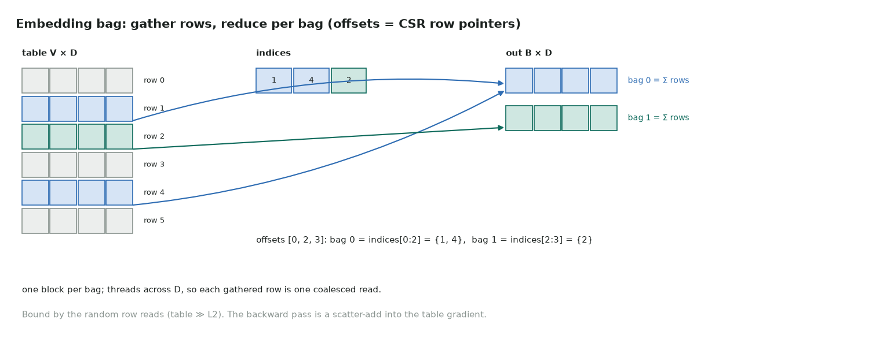

# 9. Embedding bag

Full code: [09_embedding_bag.cu](https://github.com/Prakash-sa/GPU-ultimatum/blob/main/docs/kernels/src/09_embedding_bag.cu) · recommender models (DLRM), bag-of-words features



Each output row is the sum (or mean) of a variable number of table rows. The bags are
stored like rows of a sparse matrix: `offsets[b]` to `offsets[b+1]` in `indices`. One
block handles one bag, with its threads spread across the embedding dimension, so every
gathered row is read with coalesced loads.

```cuda
for (int d = threadIdx.x; d < D; d += blockDim.x) {
    float acc = 0.0f;
    for (int j = offsets[b]; j < offsets[b + 1]; ++j)
        acc += table[(long long)indices[j] * D + d];     // gather a random row
    out[(long long)b * D + d] = mean ? acc / count : acc;
}
```

| | |
|---|---|
| Bound by | random row reads: real tables are gigabytes, far larger than L2 |
| Plain embedding | the special case of one index per bag |
| Backward | a scatter-add of gradients into the table ([LeetGPU 11](../leetgpu/11-scatter-add.md)); hot rows contend on atomics |
| At scale | tables are sharded across GPUs, with an all-to-all exchange of looked-up rows |

Tested against `F.embedding_bag(…, include_last_offset=True)` in sum and mean modes,
including an empty bag.
