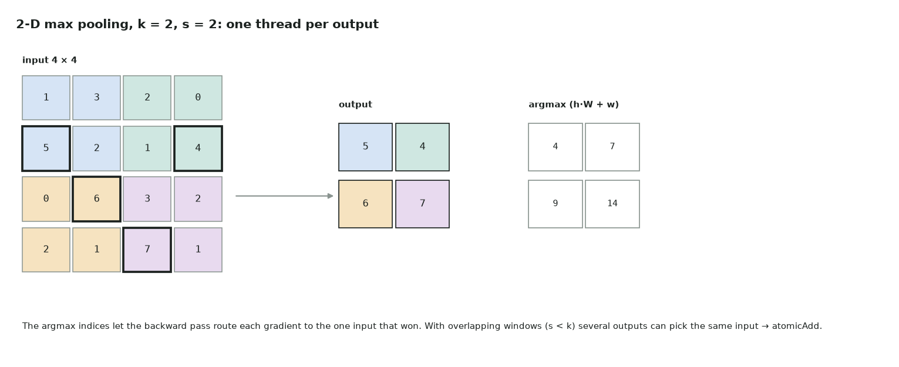

# 10. 2-D max pooling

Full code: [10_maxpool2d.cu](https://github.com/Prakash-sa/GPU-ultimatum/blob/main/docs/kernels/src/10_maxpool2d.cu) · CNN downsampling



One thread per output: scan its k × k window, keep the maximum, and record **where** it
was. The backward pass needs those indices to send each gradient to the one input that
won.

```cuda
for (int u = 0; u < k; ++u)
    for (int v = 0; v < k; ++v) {
        float val = xp[(oh * s + u) * W + ow * s + v];
        if (val > best || isnan(val)) { best = val; arg = (oh * s + u) * W + ow * s + v; }
    }
y[o] = best;  idx[o] = arg;
```

| | |
|---|---|
| Bound by | memory. Neighbouring threads read neighbouring windows, so the overlap is served by L1 |
| Ties and NaN | the first maximum wins and NaN propagates, as in PyTorch |
| Backward | `grad_x[idx[o]] += grad_y[o]`. When windows overlap (s < k), several outputs can name the same input, so this needs atomics or a gather formulation |
| Layout | NCHW here. In NHWC, threads run along C, which coalesces better for channel-last networks |

Tested against `F.max_pool2d(…, return_indices=True)` for both values and indices, with
overlapping windows (k = 3, s = 1 and s = 2).
