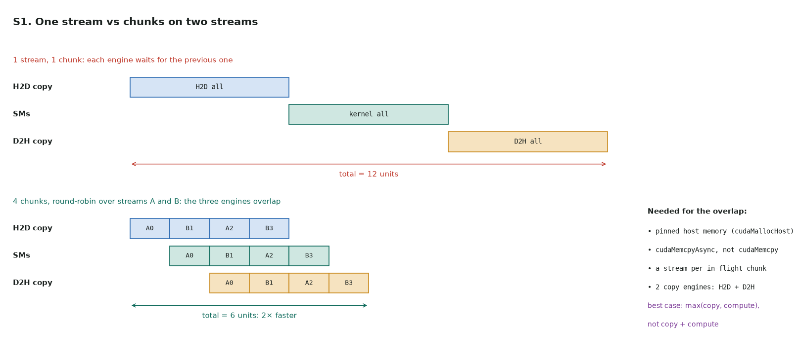

# S1. Pipelined copy + compute

Full code: [s1_stream_pipeline.cu](https://github.com/Prakash-sa/GPU-ultimatum/blob/main/docs/leetgpu/s1_stream_pipeline.cu) · practice problem in LeetGPU's format (not on LeetGPU) · theory: [note 4, streams](../notes/04-streams.md#streams)

**Problem.** `x` and `y` are **host** arrays of length `n`, in pinned memory. Compute
`y[i] = x[i] * x[i] + 1` on the GPU. Because the data starts and ends on the host, the
copies are part of the work. Use `num_streams` streams (1 to 8) so that copies and the
kernel overlap.

```cuda
extern "C" void solve(const float* h_x, float* h_y, int n, int num_streams);
```



Split the array into chunks and give each chunk its own copy-in → kernel → copy-out on a
stream, round-robin. While chunk *c* runs on the SMs, chunk *c + 1* is copied in and
chunk *c − 1* is copied out.

```cuda
for (int c = 0; c < chunks; ++c) {
    cudaStream_t st = s[c % num_streams];
    cudaMemcpyAsync(d_x + off, h_x + off, bytes, cudaMemcpyHostToDevice, st);
    square_plus_one<<<(len + 255) / 256, 256, 0, st>>>(d_x + off, d_y + off, len);
    cudaMemcpyAsync(h_y + off, d_y + off, bytes, cudaMemcpyDeviceToHost, st);
}
for (int k = 0; k < num_streams; ++k) cudaStreamSynchronize(s[k]);   // h_y is ready now
```

| | |
|---|---|
| Best case | time ≈ max(H2D, kernel, D2H) instead of their sum. Here the kernel is trivial, so the result is bound by PCIe/NVLink copy bandwidth |
| Chunk count | 4 chunks per stream. Too few and the pipeline barely fills; too many and each copy is too small to reach full bandwidth (aim for ≥ 1 MB per copy) |
| Pinned memory | with pageable memory, `cudaMemcpyAsync` stages through a driver buffer and does not overlap |
| Ordering | one chunk's three steps share a stream, so they stay in order without events |
| Profile | `nsys profile`: the timeline should show the copy rows and the kernel row overlapping |

**Tested:** the output equals `x * x + 1` exactly, for 1 to 4 streams and sizes that don't
divide evenly into chunks. A broken version that copies each chunk back on the *next*
stream (so the copy no longer waits for its kernel) fails the tests.
