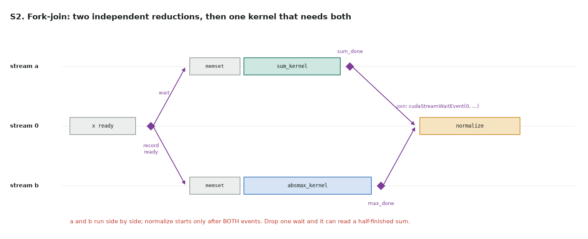

# S2. Fork-join with events

Full code: [s2_fork_join.cu](https://github.com/Prakash-sa/GPU-ultimatum/blob/main/docs/leetgpu/s2_fork_join.cu) · practice problem in LeetGPU's format (not on LeetGPU) · theory: [note 4, events](../notes/04-streams.md#events)

**Problem.** `x` (length `n`, on the device) → `out[i] = (x[i] − mean(x)) / max|x|`, or 0
when `max|x| = 0`. The mean and the max don't depend on each other, so compute them at
the same time on two streams, then **join** before the kernel that needs both.

```cuda
extern "C" void solve(const float* x, float* out, int n);
```



```cuda
cudaEventRecord(ready, 0);                                    // fork
cudaStreamWaitEvent(a, ready, 0);   cudaStreamWaitEvent(b, ready, 0);
sum_kernel<<<G, T, 0, a>>>(x, n, sum);        cudaEventRecord(sum_done, a);
absmax_kernel<<<G, T, 0, b>>>(x, n, amax);    cudaEventRecord(max_done, b);
cudaStreamWaitEvent(0, sum_done, 0);  cudaStreamWaitEvent(0, max_done, 0);   // join
normalize<<<(n + T - 1) / T, T>>>(x, out, n, sum, amax);
```

| | |
|---|---|
| Waits | `cudaStreamWaitEvent` makes a **stream** wait; the host keeps going. `cudaEventSynchronize` would block the host instead |
| Non-blocking streams | `a` and `b` are created with `cudaStreamNonBlocking`, so stream 0 doesn't wait for them implicitly. The joins are what make the result correct |
| The max | `|x| ≥ 0`, and non-negative floats sort like their bit patterns, so `atomicMax` on `__float_as_uint` is an exact float max |
| Where it pays | when each branch alone can't fill the GPU (small n, or a branch that is a short chain of kernels). Two large kernels just take turns on the SMs |
| Also | the same DAG can be captured into a CUDA Graph ([S4](s4-cuda-graph.md)); a captured fork-join becomes parallel graph branches |

**Tested:** against PyTorch (`1e-5`), sizes 1 to 65,537 and an all-zero input. Deleting
a join lets `normalize` read a sum or max that isn't finished. Whether that shows depends
on timing, so the small cases run 12 times each: with the sum join deleted the tests
failed in 5 of 5 runs, with the max join deleted in 4 of 5.
