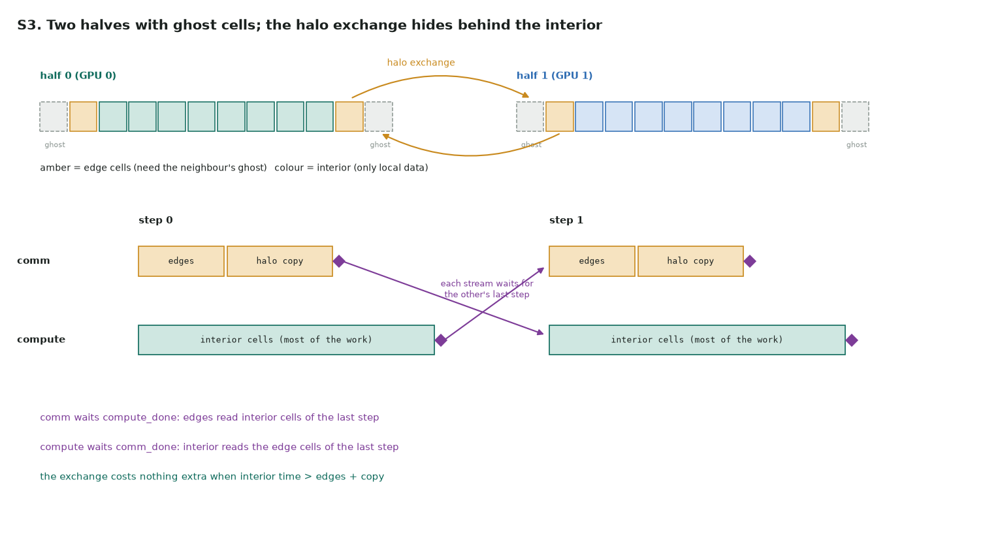

# S3. Hide the halo exchange behind interior work

Full code: [s3_halo_overlap.cu](https://github.com/Prakash-sa/GPU-ultimatum/blob/main/docs/leetgpu/s3_halo_overlap.cu) · practice problem in LeetGPU's format (not on LeetGPU) · theory: [note 4, overlapping communication and computation](../notes/04-streams.md#overlapping-communication-and-computation)

**Problem.** Run `steps` explicit steps of the 1-D heat equation on `u0` (n ≥ 4 points,
both end points fixed) and write the result to `u`:

`u'[i] = u[i] + alpha · (u[i−1] − 2·u[i] + u[i+1])`

Split the domain into two halves with ghost cells, as if each half were on its own GPU,
and overlap the halo exchange with the interior update.

```cuda
extern "C" void solve(const float* u0, float* u, int n, int steps, float alpha);
```



Only the two edge cells of each half need the neighbour's data. So each step:

1. on `comm`: update the edge cells, then copy them into the neighbour's ghost cells;
2. on `compute`, at the same time: update the interior cells, which need only local data.

```cuda
cudaStreamWaitEvent(comm, compute_done, 0);      // the previous step of the other stream
cudaStreamWaitEvent(compute, comm_done, 0);
heat_edges<<<1, 2, 0, comm>>>(...);   cudaMemcpyAsync(ghost, edge, 4, D2D, comm);   // ×2
cudaEventRecord(comm_done, comm);
heat<<<..., compute>>>(cur, nxt, 2, m - 1, alpha);  cudaEventRecord(compute_done, compute);
swap(cur, nxt);
```

| | |
|---|---|
| Why two waits | comm's edges read interior cells of the last step (and overwrite a buffer the interior read); the interior reads edge cells of the last step. Both directions are real dependencies |
| Order of calls | the waits come **before** this step's records, so each one refers to the other stream's *previous* step. Recording first would serialize the streams |
| Overlap condition | interior time ≥ edges + copy. In 3-D the halo is a surface and the interior a volume, so this holds once each GPU's block is large |
| On real multi-GPU | the copies become `cudaMemcpyPeerAsync` or NCCL send/recv on `comm`; the stream structure stays the same |
| Same in Triton? | no stream control inside Triton; you'd launch from PyTorch with `torch.cuda.Stream` and `wait_stream` |

**Tested:** bit-exact against a PyTorch loop, for n = 4 to 1000 and up to 50 steps.
Deleting either wait makes the tests fail.
