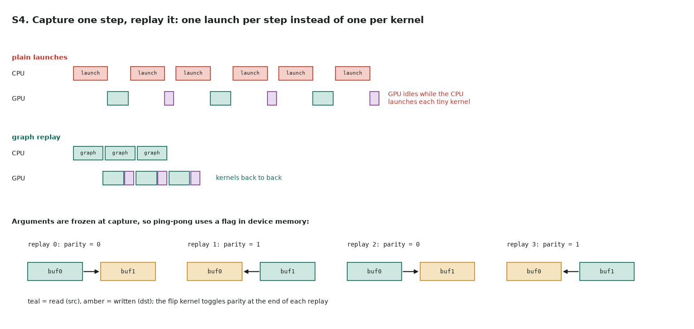

# S4. Capture a time step in a CUDA Graph

Full code: [s4_cuda_graph.cu](https://github.com/Prakash-sa/GPU-ultimatum/blob/main/docs/leetgpu/s4_cuda_graph.cu) · practice problem in LeetGPU's format (not on LeetGPU) · theory: [note 4, CUDA Graphs](../notes/04-streams.md#cuda-graphs)

**Problem.** The same heat equation as [S3](s3-halo-overlap.md), on one GPU. Each step is
tiny, so the cost is launch overhead, not math. Capture one step into a CUDA Graph and
replay it `steps` times.

```cuda
extern "C" void solve(const float* u0, float* u, int n, int steps, float alpha);
```



```cuda
cudaStreamBeginCapture(s, cudaStreamCaptureModeGlobal);       // record, don't run
heat_step<<<blocks, 256, 0, s>>>(buf0, buf1, parity, n, alpha);
flip<<<1, 1, 0, s>>>(parity);                                  // parity ^= 1
cudaStreamEndCapture(s, &graph);
cudaGraphInstantiate(&exec, graph, 0);
for (int t = 0; t < steps; ++t) cudaGraphLaunch(exec, s);      // one launch per step
```

The catch: kernel **arguments are frozen at capture**. Swapping `buf0` and `buf1` on the
host between replays changes nothing, because the graph still holds the pointers it
captured. So the kernel reads a parity flag in device memory and picks its source and
destination there:

```cuda
const float* src = *parity ? buf1 : buf0;
float*       dst = *parity ? buf0 : buf1;
```

| | |
|---|---|
| Saves | roughly one launch (a few µs) per kernel per step, plus CPU time. Worth it when kernels run for tens of µs or less |
| Other ways to ping-pong | capture **two** steps (A→B, then B→A) and replay `steps / 2` times; or update arguments with `cudaGraphExecKernelNodeSetParams` |
| Allowed during capture | async work on the captured stream only. `cudaMalloc`, `cudaMemcpy` (sync) and `cudaStreamSynchronize` are errors while capturing |
| Bigger graphs | capture 10 or 100 steps per graph to cut the per-launch cost further |
| From Python | `torch.cuda.CUDAGraph` / `torch.cuda.graph(g)` capture the same way, with the same frozen-pointer rule (static input buffers) |

**Tested:** bit-exact against a PyTorch loop, for odd and even step counts up to 101.
Removing the flip kernel, or the stream synchronize before the final copy, makes the
tests fail.
