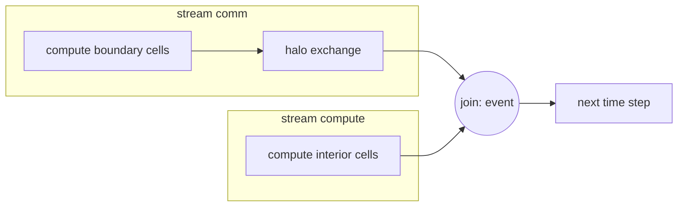

# 4. Streams and concurrency

!!! tip "Practice"
    Four tested problems in LeetGPU's format go with this note:
    [S1 pipelined copies](../leetgpu/s1-stream-pipeline.md),
    [S2 fork-join with events](../leetgpu/s2-fork-join.md),
    [S3 halo overlap](../leetgpu/s3-halo-overlap.md) and
    [S4 CUDA Graph replay](../leetgpu/s4-cuda-graph.md).

## Streams

A **stream** is an ordered queue of GPU work. Operations within one stream run in
order; operations in different streams **may** overlap.

```cpp
cudaStream_t s[2];
for (auto& st : s) cudaStreamCreate(&st);

for (int c = 0; c < nChunks; ++c) {
    cudaStream_t st = s[c % 2];
    cudaMemcpyAsync(d_in + off(c), h_in + off(c), bytes, cudaMemcpyHostToDevice, st);
    kernel<<<grid, block, 0, st>>>(d_in + off(c), d_out + off(c));
    cudaMemcpyAsync(h_out + off(c), d_out + off(c), bytes, cudaMemcpyDeviceToHost, st);
}
cudaDeviceSynchronize();
```


*Splitting the work into chunks on several streams lets the copy engines and the SMs work at the same time. Here that halves the total time.*

What has to be true for overlap:

- Host buffers must be **pinned** (`cudaMallocHost`). With pageable memory the
  "async" copy is staged and effectively synchronous.
- The GPU must have free copy engines (most data-center cards have 2 or more: one
  for H2D and one for D2H).
- Don't use the legacy **default stream** (stream 0), which synchronizes with all
  other blocking streams. Compile with `--default-stream per-thread` or create your
  own non-blocking streams.

## Events

```cpp
cudaEvent_t start, stop;
cudaEventCreate(&start); cudaEventCreate(&stop);
cudaEventRecord(start, stream);
kernel<<<g, b, 0, stream>>>(...);
cudaEventRecord(stop, stream);
cudaEventSynchronize(stop);
float ms; cudaEventElapsedTime(&ms, start, stop);
```

- Use events to time GPU work. CPU timers measure launch overhead unless you
  synchronize first.
- `cudaStreamWaitEvent(streamB, evA)` makes stream B wait for an event in stream A
  without blocking the host. This is how you express cross-stream dependencies.

## Overlapping communication and computation

The typical pattern for a domain-decomposed solver:

1. Compute the **boundary** (halo-adjacent) cells first, in stream `comm`.
2. Start the halo exchange (copy or NCCL send/recv) in `comm`.
3. Compute the **interior** cells in stream `compute` while the exchange runs.
4. Join the streams with an event before the next step.



*The overlap pattern: the interior update hides the halo exchange.*

## CUDA Graphs

When a time step consists of many small kernels, launch overhead (~2–5 µs each) can
dominate. Capture the step once and replay it:

```cpp
cudaGraph_t graph; cudaGraphExec_t exec;
cudaStreamBeginCapture(stream, cudaStreamCaptureModeGlobal);
step(stream);                         // all kernels/copies issued into `stream`
cudaStreamEndCapture(stream, &graph);
cudaGraphInstantiate(&exec, graph, 0);

for (int t = 0; t < nSteps; ++t) cudaGraphLaunch(exec, stream);
```

- Kernel parameters are fixed at capture time. Use `cudaGraphExecKernelNodeSetParams`
  or device-side indirection (e.g. a pointer that holds the current buffer index)
  for ping-pong buffers.
- Graphs are also available from PyTorch (`torch.cuda.graphs`) and CuPy.

## Synchronization costs

| Call | Blocks |
|---|---|
| `cudaDeviceSynchronize()` | host, until all work on the device finishes |
| `cudaStreamSynchronize(s)` | host, until stream `s` finishes |
| `cudaEventSynchronize(e)` | host, until event `e` completes |
| `cudaMemcpy` (non-async) | host, plus implicit synchronization |
| `cudaMalloc` / `cudaFree` | may implicitly synchronize the device |

Avoid allocating inside the time loop. Allocate once, or use the stream-ordered
allocator (`cudaMallocAsync` / memory pools).
