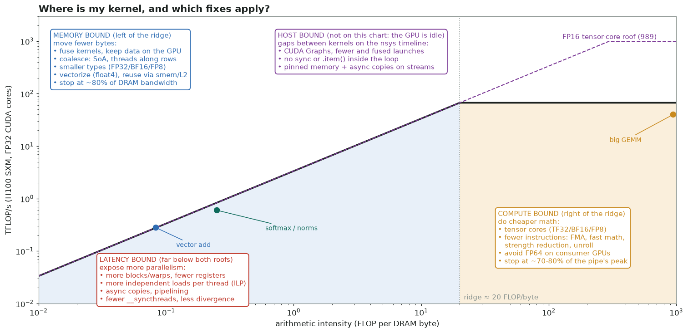
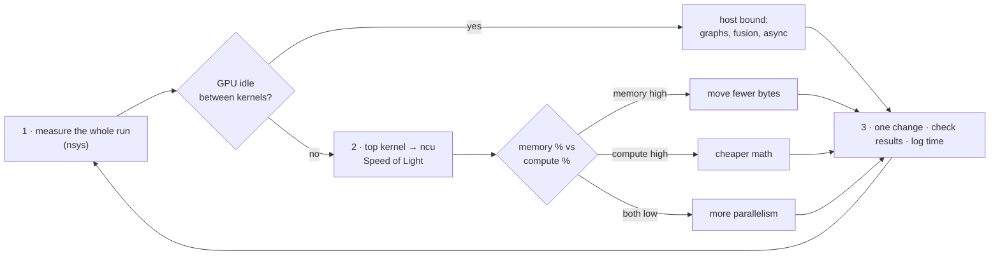

# Optimization cheat sheet

One page to decide **what to fix next**. The reasoning behind each line is in
[Performance optimization](03-performance.md) and the
[Optimization strategies playbook](09-optimization-strategies.md). How to get the numbers
is on the [Profiling cheat sheet](profiling-cheatsheet.md).

## The loop

**Stop** at about 80% of the relevant roof. Past that, only a different algorithm helps.

## Classify in 10 seconds

| Speed of Light: memory | Speed of Light: compute | It is… | First move |
|---|---|---|---|
| > 60% | low | **memory bound** | cut bytes: fuse, coalesce, smaller types |
| low | > 60% | **compute bound** | cheaper math: tensor cores, fewer instructions |
| low | low | **latency bound** | more warps or more ILP; remove stalls |
| high | high | at the hardware limit | change the algorithm |
| GPU idle in `nsys` | — | **host bound** | CUDA Graphs, fewer syncs, overlap copies |

Ridge points (FLOP per DRAM byte at which compute and memory limits meet):

| GPU | FP32 CUDA cores | FP16/BF16 tensor cores (dense) |
|---|---|---|
| T4 | 8.1 TFLOP/s ÷ 320 GB/s ≈ **25** | 65 ÷ 0.32 ≈ 200 |
| A100 80 GB | 19.5 ÷ 2.0 TB/s ≈ **10** | 312 ÷ 2.0 ≈ 155 |
| H100 SXM | 67 ÷ 3.35 TB/s ≈ **20** | 989 ÷ 3.35 ≈ 295 |

Elementwise ops (~0.1), reductions and norms (~0.25–1) and stencils (~1–5) are far left
of every ridge: memory bound everywhere. Large GEMMs and attention are compute bound.

## The fixes, ranked by typical payoff

=== "Memory bound"

    1. **Keep data on the GPU.** No `cudaMemcpy` inside the time loop.
    2. **Fuse kernels.** Every intermediate written to DRAM and read back costs 2× its
       size.
    3. **Coalesce.** Threads `t, t+1, …` read addresses `a, a+4, …`: use structs of
       arrays, and run threads along the fastest-varying index.
    4. **Smaller types.** FP32 → BF16/FP16 → FP8, with an FP32 accumulator.
    5. **Reuse on chip.** Shared-memory tiles, register blocking, L2 persistence for hot
       data.
    6. **Wider loads.** `float4` (16 B per thread) means fewer instructions for the same
       bytes.
    7. **Enough bytes in flight.** Little's law: an H100 needs ~2 MB in flight (~15 KB
       per SM). Use more warps, unrolled loads or async copies.

=== "Compute bound"

    1. **Tensor cores.** TF32, `tf32x3`, BF16 or FP8 for matmul-shaped work, with the
       precision checked against the tolerance.
    2. **Fewer instructions.** FMA, `__expf`/`rsqrtf`, hoisting invariants out of loops,
       strength reduction, `#pragma unroll`.
    3. **Avoid the slow pipes.** FP64 on consumer GPUs (1/64 rate), integer division,
       transcendental functions in inner loops.
    4. **Less divergence.** Make branches uniform per warp: sort or bin the work.
    5. **Check the work itself:** skip zeros only when that skips *tiles*, not single
       elements.

=== "Latency bound"

    1. **More parallelism.** At least 4 blocks per SM, or a persistent grid with ILP.
    2. **Fewer registers** (`__launch_bounds__`, fewer live variables), so more warps fit.
       Check for spills.
    3. **Independent work per thread.** Several loads in flight before the first use.
    4. **Pipelining.** `cp.async` / TMA double buffering on sm_80+ and sm_90.
    5. **Fewer barriers.** Warp shuffles instead of shared memory plus
       `__syncthreads()`.
    6. **Small problems.** Split-K, smaller tiles, or batch several problems into one
       launch.

=== "Host bound"

    1. **CUDA Graphs** for repeated sequences of small kernels.
    2. **No hidden syncs.** `.item()`, `.cpu()`, `print(tensor)`, `cudaMemcpy` and
       allocations inside the loop all synchronize.
    3. **Overlap.** Pinned memory, `cudaMemcpyAsync` on streams, compute while copying.
    4. **Fuse or batch** tiny kernels: `torch.compile`, a Triton kernel, or a grouped
       GEMM.
    5. **Pre-allocate.** Caching allocators, and no `cudaMalloc` in the loop.

## Symptom → cause → fix

| You see | Likely cause | Fix |
|---|---|---|
| Gaps between kernels in `nsys` | launch overhead, host work, syncs | CUDA Graphs, fusion, remove syncs |
| `cudaMemcpy` every step | data shuttles to the host | keep it resident; copy only diagnostics |
| DRAM throughput > 80% and still slow | too many bytes | fusion, smaller types, in-place algorithms |
| Sectors per request ≫ 4 (4-byte loads) | uncoalesced access | SoA layout, threads along rows, transpose through shared memory |
| Shared-memory bank conflicts > 0 | strided shared-memory index | pad (`[32][33]`), sequential addressing |
| Spill stores in `-Xptxas -v` | too many live registers | `__launch_bounds__`, smaller tiles, split the kernel |
| Achieved occupancy ≪ theoretical | tail effects, imbalance, few blocks | more, smaller blocks; grid-stride loops |
| Theoretical occupancy low | registers or shared memory per block | reduce them, or accept it if ILP is high |
| Mostly *Long Scoreboard* stalls | waiting on global memory | coalesce, prefetch, ILP, shared-memory reuse |
| *Barrier* stalls | uneven work before `__syncthreads` | balance it, use fewer barriers, use shuffles |
| *Math Pipe Throttle* at high SM % | compute bound on one pipe | tensor cores or a cheaper instruction mix |
| Fast alone, slow in the app | L2 or clock state, contention | profile in context; check clocks and other streams |
| Results change run to run | float atomics, races | deterministic reductions; `compute-sanitizer --tool racecheck` |
| Scaling flat from 8 to 16 GPUs | inter-node communication | overlap, topology-aware placement, see [Multi-GPU](10-multi-gpu-communication.md) |

## Rules of thumb

| Knob | Start with | Why |
|---|---|---|
| Threads per block | 128–256 (a multiple of 32) | enough warps without exceeding registers or shared memory |
| Blocks | ≥ 4 × SMs, or a persistent grid of 1–4 per SM | fill the GPU, hide tail effects |
| Elements per thread | 4–16 for bandwidth kernels | ILP and fewer blocks to schedule |
| Load width | 16 bytes (`float4`) | fewest instructions per byte |
| Shared-memory tile | `[32][33]` for transposes | the padding removes bank conflicts |
| Accumulation | FP32 for FP16/BF16 data; FP64 or pairwise for long FP32 sums | precision is part of correctness ([example](../leetgpu/21-matrix-multiplication.md#precision-and-summation-order-decide-the-result)) |
| When to stop | ~80% of the roof that applies | the rest needs a new algorithm |

## Before you claim a speedup

- Results match the reference within the tolerance, at awkward sizes (1, 31, 33, 2^k + 1).
- Timings are a warm median of many runs, with L2 flushed. Report the GPU model, clocks,
  CUDA version and size.
- Compare against a strong baseline (cuBLAS, `torch.compile`), not the naive kernel.
- Log every step: change → time → speedup → bandwidth → parity
  ([template](09-optimization-strategies.md#optimization-log-template)).
