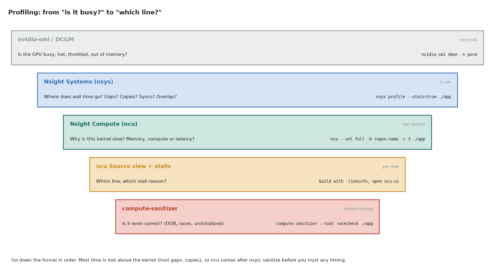

# Profiling cheat sheet

One page of **commands, metrics and what they mean**. The full walkthrough is in
[Profiling and debugging](06-profiling.md). What to do with the answers is on the
[Optimization cheat sheet](optimization-cheatsheet.md).



## Pick the tool

| Question | Tool | One-liner |
|---|---|---|
| Is the GPU busy, hot, throttled, out of memory? | `nvidia-smi` | `nvidia-smi dmon -s pucm` |
| Why are the clocks low? | `nvidia-smi` | `nvidia-smi -q -d PERFORMANCE` (throttle reasons) |
| Where does the wall time go? | Nsight Systems | `nsys profile --stats=true -o rep ./app` |
| Which kernels cost the most? | Nsight Systems | `nsys stats --report cuda_gpu_kern_sum rep.nsys-rep` |
| Why is this kernel slow? | Nsight Compute | `ncu --set full -k regex:my_kernel -c 3 -o k ./app` |
| One number, fast | Nsight Compute | `ncu --metrics dram__throughput.avg.pct_of_peak_sustained_elapsed ./app` |
| Out-of-bounds, races, bad syncs? | compute-sanitizer | `compute-sanitizer --tool memcheck ./app` |
| Registers, spills, shared memory per kernel | nvcc | `nvcc -Xptxas -v …` |
| PyTorch: which ops and kernels? | `torch.profiler` | see [Python](#python) |
| A Triton or PyTorch kernel's time | Triton | `triton.testing.do_bench(fn)` |

## Nsight Systems: reading the timeline

```bash
nsys profile -t cuda,nvtx,osrt --cuda-memory-usage=true --stats=true -o rep ./app
nsys profile --capture-range=cudaProfilerApi ./app     # only between cudaProfilerStart/Stop
nsys profile --gpu-metrics-devices=all ./app            # SM/DRAM activity over time (older nsys: --gpu-metrics-device)
nsys stats --report cuda_gpu_kern_sum,cuda_gpu_mem_time_sum,cuda_api_sum rep.nsys-rep
```

| On the timeline | It means | Look at |
|---|---|---|
| White gaps between kernels | the GPU waits for the host | launch overhead, Python, syncs → CUDA Graphs |
| `cudaMemcpy` HtoD/DtoH every iteration | data shuttling | keep it resident |
| `cudaStreamSynchronize` / `cudaDeviceSynchronize` in the loop | serialization | remove, or use events |
| Copies and kernels never overlap | one stream, or pageable memory | pinned memory + `cudaMemcpyAsync` on separate streams |
| Hundreds of tiny kernels | unfused elementwise ops | fusion, `torch.compile` |
| NCCL kernels on the critical path | communication not overlapped | overlap it with compute; see the topology |
| CPU threads busy in `cudaLaunchKernel` | launch bound | CUDA Graphs, bigger kernels |

Add NVTX ranges (`nvtxRangePushA("step")` / `torch.cuda.nvtx.range("step")`) so the
timeline shows your phases by name.

## Nsight Compute: the sections, in reading order

```bash
ncu --set full -k regex:collide -c 3 -o k ./app        # full report for 3 matching launches
ncu --section SpeedOfLight --section MemoryWorkloadAnalysis ./app
ncu --launch-skip 10 -c 1 …                             # skip warm-up launches
ncu --clock-control none …                              # don't lock clocks to base
ncu --query-metrics                                     # list every metric name
ncu-ui k.ncu-rep                                        # GUI, with the Source view
```

1. **GPU Speed of Light**: memory % vs compute %, which classifies the kernel.
2. **Memory Workload Analysis**: DRAM bytes, L1/L2 hit rates, coalescing, bank
   conflicts.
3. **Compute Workload Analysis**: which pipe is busy (FMA, ALU, tensor, FP64).
4. **Occupancy**: theoretical vs achieved, and the limiter (registers, shared memory,
   block size).
5. **Warp State Statistics**: why warps stall (table below).
6. **Source**: SASS and source side by side, with stalls per line (build with
   `-lineinfo`).

## Metrics worth memorizing

| Metric | Meaning | Healthy |
|---|---|---|
| `gpu__time_duration.sum` | kernel time | — |
| `gpu__compute_memory_throughput.avg.pct_of_peak_sustained_elapsed` | memory Speed of Light | > 60% for a memory-bound kernel |
| `sm__throughput.avg.pct_of_peak_sustained_elapsed` | compute Speed of Light | > 60% for a compute-bound kernel |
| `dram__throughput.avg.pct_of_peak_sustained_elapsed` | DRAM bandwidth used | 80–90% is excellent |
| `dram__bytes_read.sum`, `dram__bytes_write.sum` | bytes actually moved | close to the ideal you computed |
| `lts__t_sector_hit_rate.pct` | L2 hit rate | high when reuse is expected |
| `l1tex__t_sectors_pipe_lsu_mem_global_op_ld.sum` ÷ `l1tex__t_requests_pipe_lsu_mem_global_op_ld.sum` | sectors per load request | 4 for 4-byte coalesced loads; ≫ 4 means scattered |
| `l1tex__data_bank_conflicts_pipe_lsu_mem_shared_op_ld.sum` | shared-memory bank conflicts | 0 |
| `sm__warps_active.avg.pct_of_peak_sustained_active` | achieved occupancy | close to theoretical |
| `launch__registers_per_thread` | registers per thread | low enough for the occupancy you need |
| `launch__occupancy_limit_registers`, `launch__occupancy_limit_shared_mem` | blocks per SM allowed by each resource | the smallest one is the limiter |
| `smsp__thread_inst_executed_per_inst_executed.ratio` | active threads per instruction | 32 = no divergence |

## Stall reasons (Warp State Statistics)

| Stall | The warp is waiting for | Usual fix |
|---|---|---|
| **Long Scoreboard** | global or local memory (an L1TEX load) | coalesce, prefetch, ILP, reuse in shared memory, fix spills |
| **Short Scoreboard** | shared memory or special math (MUFU) | remove bank conflicts, fewer transcendentals |
| **MIO Throttle** | the shared-memory / shuffle / special-math queue | fewer, wider shared-memory accesses |
| **LG Throttle** | the global/local memory instruction queue | `float4` loads (fewer instructions), remove spills |
| **Barrier** | other warps at `__syncthreads()` | balance the work before it, fewer barriers |
| **Math Pipe Throttle** | a busy execution pipe | compute bound: fine near peak; otherwise use tensor cores |
| **Wait** | a fixed-latency dependency | more independent instructions (unroll, ILP) |
| **Branch Resolving** | branch target computation | fewer, more uniform branches |
| **Membar** | a memory fence | fewer `__threadfence()` calls, narrower scope |
| **Not Selected** | nothing: another eligible warp issued | fine; there is spare parallelism |

## Python

```python
import torch
from torch.profiler import profile, ProfilerActivity

with profile(activities=[ProfilerActivity.CPU, ProfilerActivity.CUDA], record_shapes=True) as prof:
    for _ in range(10):
        step()
    torch.cuda.synchronize()
print(prof.key_averages().table(sort_by="cuda_time_total", row_limit=15))
prof.export_chrome_trace("trace.json")          # open in Perfetto / chrome://tracing

from triton.testing import do_bench
ms = do_bench(lambda: my_kernel(x), warmup=25, rep=100)   # median, L2 flushed
```

`time.time()` around a GPU call measures only the launch, unless you call
`torch.cuda.synchronize()` first. Use `do_bench` or CUDA events.

## Debugging quick reference

| Problem | Command |
|---|---|
| Out-of-bounds or misaligned access | `compute-sanitizer --tool memcheck ./app` |
| Shared-memory data race | `compute-sanitizer --tool racecheck ./app` |
| Reading uninitialized device memory | `compute-sanitizer --tool initcheck ./app` |
| Invalid `__syncthreads` usage | `compute-sanitizer --tool synccheck ./app` |
| Error reported at the wrong call | `CUDA_LAUNCH_BLOCKING=1 ./app` (each launch then synchronizes) |
| Step through device code | build with `-G -g`, run `cuda-gdb ./app` |
| Source lines in reports | build with `-lineinfo` (keeps optimizations) |

## Measurement hygiene

- **Warm up.** The first launch includes JIT compilation, module loading and
  allocation.
- **Many runs.** Report the median and spread, not the minimum of one run.
- **Flush L2** between runs for DRAM-bound kernels (`do_bench` does). Otherwise you
  measure L2 bandwidth.
- **Clocks.** `ncu` locks clocks to base by default (`--clock-control none` turns that
  off). Boost clocks and thermals vary, so lock them (`nvidia-smi -lgc`) when allowed.
- **Profile the real size** in the real application. A kernel alone may enjoy a warm
  L2 it never gets in production.
- **Record everything:** GPU model, driver, CUDA version, clocks, problem size and
  commit.
